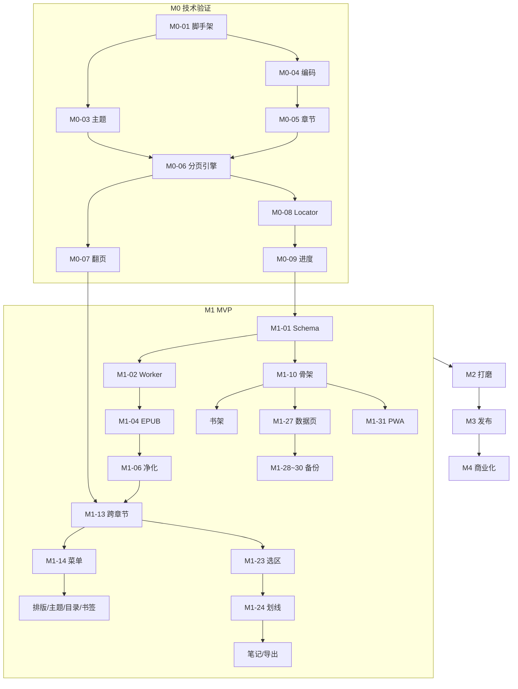

# 静页 PWA 开发计划

| 项目 | 内容 |
| --- | --- |
| 对应文档 | [PRD.md](./PRD.md) v0.1 |
| 版本 | v0.1 |
| 日期 | 2026-10-02 |
| 开发方式 | 代码主要由 AI 编写，开发者负责拆任务、审查、真机验收 |

---

## 0. 如何使用本计划

### 当前执行状态（2026-10-10）

以下为实际进度摘要，未覆盖的退出标准继续保留，不以代码实现代替真机验收；完整证据见 DEVELOPMENT_STATUS.md。

| 范围 | 当前完成 | 仍需完成 |
| --- | --- | --- |
| M0/M1 | 主要代码、372 单测，本地/CI 完整浏览器均 102 通过/1 已知 Windows WebKit 离线 skip | 两台物理手机、七天自用、完整阶段验收 |
| M2-02/03/04/05 | 新增 17 项引导/环境/可信触摸专项；修复弹窗焦点/返回与全屏状态；线上引导/可信拖动 3/3 | 真实微信/QQ、系统安装、长按/拇指误触/帧率 |
| M2 其他 | 已有编码、系统深色、提醒、大书、21 本 EPUB 选定正文、备份、安全和更新证据 | 真机性能/大库内存、整本其他复杂页面、完整安全审计 |
| M3-01 | 用户指定公开 reader 仓库已上传；README 截图、原创 MD 体验包与 CONTRIBUTING 已提供 | 用户选择许可证；M2 全部退出条件仍待补 |
| M3-02 | main 6ce56cd 的 CI 38019710585 全部检查通过；完整 102/1、像素变异/恢复及独立红色 CI 均核验 | CI 附件保留 14 天，本机证据另存 |
| M3-03 | 原账号/原项目 dd14fa8b 已上线，三地址各 113 资源 SHA/安全/缓存头及线上 4+3 项通过 | main 自动发布需配置 Cloudflare secrets 并启用；PWA 真机安装 |
| M3-04/05 | CHANGELOG、关于页版本、源码/Issues/Gmail 入口 | 正式 tag、打赏地址 |
| M3-06/07 | 应用在线、发布素材初步齐备 | 独立落地页、三个渠道发布及反馈记录 |
| M4 | 未启动 | 先收集 M3 用户反馈，再决定商业化范围 |

### 0.1 工作流

1. **一个任务 = 一次 AI 会话**。按编号顺序把任务卡片交给 AI，并要求它先阅读 `PRD.md`、`DEV_PLAN.md`、`AGENTS.md`。
2. AI 完成后，**你按卡片上的「验收」逐条操作**，全部通过再进入下一任务。
3. 验收通过 → `git commit`（一个任务一次提交，提交信息带任务编号，如 `M1-04: 解析 EPUB OPF`）。
4. 验收失败 → 在同一会话中贴出现象/截图/控制台报错，让 AI 修复；连续 3 轮修不好时，回滚到上次提交，把任务拆小重来。
5. 每个阶段结束执行一次「阶段回归」（见第 8 章），通过后打 tag（如 `v0.1.0-m0`）。

### 0.2 任务卡片格式

```
#### 编号 任务名 `复杂度`
- 依赖：前置任务
- 目标：这个任务完成后能做到什么
- 涉及：主要新增/修改的文件
- AI 要点：给 AI 的关键约束与实现提示
- 验收：你需要亲自检查的步骤（☐ 可勾选）
```

### 0.3 复杂度定义

| 等级 | 含义 | 预期 AI 会话 |
| --- | --- | --- |
| `S` | 改动集中、逻辑简单 | 1 轮即可完成 |
| `M` | 涉及 2–5 个文件或需要单测 | 1–3 轮 |
| `L` | 核心算法或跨模块，易出边界问题 | 3 轮以上，建议拆子任务 |

### 0.4 约定

- **分支**：`main` 始终可运行；每个阶段一个分支 `m0`、`m1`……，阶段回归通过后合并。
- **命令**（M0-01 后固定）：`pnpm dev` / `pnpm test` / `pnpm lint` / `pnpm build` / `pnpm preview`。
- **AI 每次结束前必须**：跑 `pnpm lint && pnpm test && pnpm build` 并全部通过，然后总结改动文件与验收方法。
- **禁止事项**（写入 AGENTS.md）：引入任何联网请求、第三方 CDN、统计 SDK；新增依赖须说明理由及 gzip 体积。

---

## 1. 准备阶段（M-1）

#### P-01 开发环境 `S`
- 依赖：—
- 目标：本机具备开发条件
- AI 要点：给出 Windows 下安装 Node.js LTS、pnpm（`corepack enable`）、Git 的步骤
- 验收：
  - ☐ `node -v`（≥ 20）、`pnpm -v`、`git --version` 均有输出

#### P-02 代码仓库 `S`
- 依赖：P-01
- 目标：`D:\电子书阅读器` 初始化为 Git 仓库并关联 GitHub 私有仓库（发布前再改为公开）
- 验收：
  - ☐ `git log` 有首个提交（包含 PRD.md、DEV_PLAN.md）
  - ☐ GitHub 网页可见仓库

#### P-03 测试素材库 `S`
- 依赖：—
- 目标：建立 `test-books/`（加入 `.gitignore`，不提交有版权的书）
- 素材清单：

| 文件 | 用途 |
| --- | --- |
| `utf8.txt` / `gbk.txt` / `gb18030.txt` / `utf8-bom.txt` / `utf16.txt` | 编码识别 |
| `webnovel-1000ch.txt`（≥ 1000 章，≥ 10MB） | 章节切分与性能 |
| `no-chapter.txt` | 无章节自动切分 |
| `epub2-ncx.epub` / `epub3-nav.epub` | 目录解析 |
| `with-images.epub` | 插图显示 |
| `no-toc.epub` / `broken.epub` / `drm.epub`（含 `encryption.xml`） | 异常处理 |
| `long-article.md` | 粘贴导入 |

- 来源建议：Project Gutenberg、Standard Ebooks（公版 EPUB），维基文库中文公版书，自己用文本编辑器另存为不同编码。
- 验收：
  - ☐ 上述文件齐全，每个能用电脑上的其他阅读器打开（确认素材本身没问题）

#### P-04 真机调试通道 `S`
- 依赖：M0-01
- 目标：手机能访问本机开发服务器，且为 HTTPS（Service Worker、剪贴板、Wake Lock 需要安全上下文）
- 方案（任选其一）：
  1. `pnpm dev --host` + `@vitejs/plugin-basic-ssl`（自签证书，手机需信任）
  2. `cloudflared tunnel --url http://localhost:5173`（获得临时 HTTPS 域名，最省事）
- 调试工具：Android 使用 USB + 电脑 Chrome `chrome://inspect`；iOS 无 Mac 时，在页面内置一个开发模式下的屏幕日志面板（M0-01 中实现 `?debug=1`）。
- 验收：
  - ☐ iPhone Safari 与 Android Chrome 均能通过 HTTPS 打开开发页面

---

## 2. M0 技术验证

**目标**：验证最大的技术风险——分页引擎与位置恢复。只做 TXT，界面可以很简陋。

**退出标准**：在 iPhone 与 Android 真机上，导入 10MB TXT，翻页流畅、无半行截断，改字号后位置不丢，杀掉进程重开能回到原页。

#### M0-01 项目脚手架 `S`
- 依赖：P-02
- 目标：可运行的空项目
- 涉及：`package.json`、`vite.config.ts`、`tsconfig.json`、`src/main.tsx`、`.eslintrc`、`.prettierrc`、`vitest.config.ts`
- AI 要点：Vite + Preact + TypeScript（strict）；ESLint + Prettier；Vitest；`@preact/signals`；路径别名 `@/`；`?debug=1` 时页面底部显示 console 日志浮层
- 验收：
  - ☐ `pnpm dev` 打开显示占位页
  - ☐ `pnpm lint`、`pnpm test`、`pnpm build` 全部通过

#### M0-02 AGENTS.md 与工程规范 `S`
- 依赖：M0-01
- 目标：AI 每次会话都能读到的项目规则
- 涉及：`AGENTS.md`
- AI 要点：写入产品原则摘要（零联网等）、技术栈、目录结构（PRD 9.3）、常用命令、代码风格、禁止事项、提交规范、"每次结束前跑 lint/test/build"
- 验收：
  - ☐ 文件内容与 PRD 原则一致，命令可直接运行

#### M0-03 主题 Token 与基础样式 `S`
- 依赖：M0-01
- 目标：4 套主题的 CSS 变量与全局重置样式
- 涉及：`src/styles/tokens.css`、`src/styles/base.css`
- AI 要点：`[data-theme="paper|eink|green|night"]` 定义 `--bg`、`--fg`、`--fg-muted`、`--accent`；系统衬线/无衬线字体栈（含 iOS `Songti SC`、Android `Noto Serif CJK`）；禁止页面弹性滚动与长按放大
- 验收：
  - ☐ 临时切换 `data-theme` 四种颜色与 PRD 6.5 一致

#### M0-04 TXT 编码识别 `M`
- 依赖：M0-01、P-03
- 目标：`decodeText(buffer: ArrayBuffer): { text, encoding }`
- 涉及：`src/parsers/txt/encoding.ts`、`encoding.test.ts`
- AI 要点：BOM 检测 → UTF-8 fatal 解码 → GB18030 → Big5；UTF-16 无 BOM 时通过偶数位 0x00 比例判断；单测使用 `test-books` 中的小样本（可将片段转成测试 fixture 提交）
- 验收：
  - ☐ 单测覆盖 5 种编码并通过
  - ☐ 任选一本 GBK 网文，返回的前 200 字不乱码

#### M0-05 TXT 章节切分与清洗 `M`
- 依赖：M0-04
- 目标：`splitChapters(text): Chapter[]`，每章为段落数组
- 涉及：`src/parsers/txt/chapters.ts`、`clean.ts`、对应单测
- AI 要点：PRD 6.1.2 的正则规则集；标题行 ≤ 30 字；第一个标题之前的内容作为"前言"；无标题时按约 5000 字在段落边界切分；清洗：统一换行、去行首空白、去空行
- 验收：
  - ☐ `webnovel-1000ch.txt` 识别章节数与实际一致（抽查 10 处）
  - ☐ `no-chapter.txt` 自动切分为"第 N 部分"
  - ☐ 正文中出现"第一次……"之类的句子不被误判为标题

#### M0-06 分页引擎原型 `L`
- 依赖：M0-03、M0-05
- 目标：把一章内容渲染为若干页，可按页码跳转
- 涉及：`src/reader/paginator.ts`、`src/pages/Reader/ReaderView.tsx`
- AI 要点：
  - 内容容器 `column-width = 内容区宽度`、`column-gap = 左右边距 × 2`，`transform: translateX(-page × pageWidth)`
  - 内容区高度 = `floor(可用高度 / 行高px) × 行高px`，余量均分到上下边距，避免半行
  - 总页数 = `ceil(scrollWidth / pageWidth)`，在 `document.fonts.ready` 后计算
  - 监听 `resize` / `orientationchange` / `visualViewport` 变化后重新分页
  - 每段 `<p data-p="段落索引">`
- 验收：
  - ☐ 真机上任意翻 20 页，页底无被截断的半行
  - ☐ 横竖屏切换后重新分页不报错
  - ☐ 字号临时改为 14 / 28，分页仍正确

#### M0-07 翻页交互 `M`
- 依赖：M0-06
- 目标：点击左/右区翻页、中区回调、滑动翻页、键盘翻页
- 涉及：`src/reader/gestures.ts`
- AI 要点：Pointer Events 统一处理；滑动阈值 > 40px 或速度 > 0.3px/ms 判定翻页，否则回弹；跟手位移；点击与选择文字不冲突（长按 > 500ms 不触发翻页）；章末向后翻、章首向前翻触发 `onChapterBoundary` 回调（M0 中直接加载相邻章）
- 验收：
  - ☐ 点击、滑动、键盘 ←/→/空格均能翻页
  - ☐ 快速连续点击 10 次不漏页、不错位
  - ☐ 章末翻页进入下一章第 1 页，章首往前翻进入上一章最后一页

#### M0-08 Locator 定位 `L`
- 依赖：M0-06
- 目标：`getLocator(page) → {chapterIndex, paragraphIndex, charOffset}` 与 `pageOf(locator) → page`
- 涉及：`src/reader/locator.ts`、单测（纯函数部分）
- AI 要点：取当前页左上角第一个可见段落；段落跨页时用 `document.caretRangeFromPoint`（Safari 用 `caretPositionFromPoint` 兼容）求字符偏移；反查时用 `Range.getClientRects()` 求偏移所在列
- 验收：
  - ☐ 在某页记下首句，字号由 18 改为 24 再改回，首句仍在当前页
  - ☐ 横竖屏切换后首句仍在当前页

#### M0-09 最小存储与进度保存 `M`
- 依赖：M0-08
- 目标：书籍与进度存入 IndexedDB，重开后恢复
- 涉及：`src/db/index.ts`（Dexie）
- AI 要点：临时表 `books`、`chapters`、`progress`；翻页后 500ms 防抖保存；`visibilitychange=hidden` 与 `pagehide` 时立即保存
- 验收：
  - ☐ 阅读到某页后，从多任务界面划掉浏览器，重开回到同一页（误差 ≤ 1 页）

#### M0-10 临时导入入口与真机验证 `S`
- 依赖：M0-09、P-04
- 目标：首页一个"选择 TXT"按钮，导入后直接进入阅读
- AI 要点：导入期间显示"解析中…"；记录导入耗时与首屏耗时，在 `?debug=1` 中输出
- 验收：
  - ☐ 执行第 8 章「M0 回归」并全部通过
  - ☐ 在 `debug` 面板记录 10MB TXT 的导入耗时与首屏耗时（作为后续优化基线）

---

## 3. M1 MVP

**目标**：实现 PRD 中全部 P0 功能，达到"自己每天都能用"。

**退出标准**：PRD 第 6 章所有 P0 验收标准通过；连续自用 7 天无数据丢失、无阻断性 Bug。

### 3.1 数据层

#### M1-01 正式数据库 Schema `M`
- 依赖：M0-09
- 目标：按 PRD 第 10 章建立完整数据模型与版本迁移
- 涉及：`src/db/schema.ts`、`src/db/index.ts`、`src/types.ts`
- AI 要点：表 `books`、`chapters`（复合主键 `[bookId+index]`）、`blobs`、`progress`、`bookmarks`、`highlights`、`settings`；Dexie `version(n).upgrade()` 迁移 M0 数据；封装 repository 函数，UI 不直接操作 Dexie
- 验收：
  - ☐ M0 时导入的书在升级后仍可阅读、进度保留
  - ☐ 浏览器 DevTools → Application → IndexedDB 可见各表

#### M1-02 Web Worker 解析管线 `M`
- 依赖：M1-01
- 目标：所有文件解析在 Worker 中进行，主线程只接收结果与进度
- 涉及：`src/workers/parse.worker.ts`、`src/parsers/index.ts`
- AI 要点：Comlink 暴露 `parse(file, onProgress)`；ArrayBuffer 用 transferable 传递；按 `type` 分发到 txt/epub/paste 解析器
- 验收：
  - ☐ 导入 10MB TXT 时，"解析中"进度动画持续流畅（不冻结）

#### M1-03 书籍指纹与去重 `S`
- 依赖：M1-01
- 目标：`fingerprint(buffer) → SHA-256 hex`，作为 `Book.id`
- 涉及：`src/db/fingerprint.ts`
- AI 要点：Web Crypto `subtle.digest`；导入已存在的书时提示"已在书架中"并跳转到该书
- 验收：
  - ☐ 同一文件导入两次，书架只有一本

### 3.2 导入

#### M1-04 EPUB 容器与 OPF 解析 `M`
- 依赖：M1-02
- 目标：解析出书名、作者、封面、spine 章节顺序
- 涉及：`src/parsers/epub/container.ts`、`opf.ts`、单测
- AI 要点：JSZip 解压；`container.xml` → OPF 路径；`DOMParser` 解析 XML；封面识别顺序：`properties="cover-image"` → `<meta name="cover">` → 第一张图片；处理相对路径
- 验收：
  - ☐ `epub2-ncx.epub`、`epub3-nav.epub` 书名作者封面正确

#### M1-05 EPUB 目录解析 `M`
- 依赖：M1-04
- 目标：生成多级目录，目录项映射到 spine 索引 + 锚点
- 涉及：`src/parsers/epub/toc.ts`、单测
- AI 要点：EPUB3 `nav[epub:type=toc]` 优先，回退 NCX；href 中 `#fragment` 记录为段落锚点；无目录时按 spine 生成"第 N 节"
- 验收：
  - ☐ 两种 EPUB 目录层级正确；`no-toc.epub` 生成默认目录

#### M1-06 XHTML 净化与图片处理 `L`
- 依赖：M1-04
- 目标：章节 HTML 安全、样式统一、图片可显示
- 涉及：`src/parsers/epub/sanitize.ts`
- AI 要点：DOMPurify 白名单（p、h1–h6、em、strong、b、i、img、br、blockquote、ul、ol、li、sup、sub、ruby、rt、hr、a 去 href 外链）；移除 style/class 但保留居中、对齐语义（转为 `data-align`）；图片转存 `blobs` 表，渲染时生成 Blob URL；块级元素统一标注 `data-p` 段落索引；计算每章字符数
- 验收：
  - ☐ `with-images.epub` 插图显示且不超出页面
  - ☐ 构造含 `<script>alert(1)</script>` 与 `onerror` 的 EPUB，导入后不弹窗
  - ☐ 阅读时 DevTools Network 面板无任何外部请求

#### M1-07 异常文件处理 `S`
- 依赖：M1-04
- 目标：DRM、损坏、超大文件给出明确提示
- AI 要点：检测 `META-INF/encryption.xml`；JSZip 抛错 → "文件无法解析"；> 50MB 拒绝；失败不写入数据库
- 验收：
  - ☐ `drm.epub`、`broken.epub`、超大文件分别显示对应提示，书架无残留

#### M1-08 导入面板 `M`
- 依赖：M1-07、M0-05
- 目标：底部弹出面板：「选择文件」「粘贴文本」；支持多选文件与逐个进度
- 涉及：`src/pages/Import/ImportSheet.tsx`
- AI 要点：`accept=".epub,.txt,text/plain,application/epub+zip"`；多文件串行导入，单个失败不影响其他；完成后单本直接进入阅读，多本回到书架
- 验收：
  - ☐ 一次选择 3 个文件（含 1 个损坏），2 本成功、1 条错误提示

#### M1-09 粘贴导入页 `M`
- 依赖：M1-08
- 目标：PRD 6.1.3
- 涉及：`src/pages/Import/PastePage.tsx`、`src/parsers/paste.ts`
- AI 要点：「从剪贴板读取」按钮（`navigator.clipboard.readText`，失败时提示手动长按粘贴）；自动标题；`#` 标题转章节；`type='paste'` 的书 id 用文本内容哈希；书籍信息中提供"编辑正文"
- 验收：
  - ☐ 粘贴 `long-article.md`，标题和章节正确，1 秒内进入阅读
  - ☐ 不填标题时自动取首行

### 3.3 应用骨架与书架

#### M1-10 路由与应用骨架 `S`
- 依赖：M1-01
- 目标：书架 / 阅读 / 粘贴 / 设置 四个页面的路由与切换
- 涉及：`src/app/router.tsx`、`src/app/App.tsx`
- AI 要点：使用 hash 路由（静态托管与离线友好）；`preact-iso` 或自写极简路由；Android 返回键 / iOS 侧滑返回行为符合直觉（阅读页返回 → 书架）
- 验收：
  - ☐ 各页面可互相跳转，Android 返回键行为正确

#### M1-11 书架列表与封面 `M`
- 依赖：M1-10
- 目标：PRD 6.2 列表展示与空状态
- 涉及：`src/pages/Bookshelf/*`、`src/components/Cover.tsx`
- AI 要点：无封面时用书名生成纸质封面（主题色背景 + 竖排书名）；显示进度百分比与"x 天前"；顶部"继续阅读"卡片；空状态文案克制
- 验收：
  - ☐ EPUB 显示原封面，TXT 显示生成封面
  - ☐ 进度百分比与阅读位置一致

#### M1-12 排序与书籍操作 `M`
- 依赖：M1-11
- 目标：排序切换；长按菜单：重命名、书籍信息、删除
- AI 要点：排序方式持久化；删除在一个事务中清理书籍、章节、blobs、进度、书签、划线；删除前二次确认并提示笔记数量
- 验收：
  - ☐ 删除一本书后，DevTools 中相关记录全部消失，存储占用下降

### 3.4 阅读器

#### M1-13 跨章节衔接与预渲染 `L`
- 依赖：M0-07、M1-06
- 目标：章节之间翻页无白屏；EPUB 与 TXT 统一渲染
- 涉及：`src/reader/ReaderEngine.ts`
- AI 要点：维护 前一章 / 当前章 / 后一章 三个分页实例，非当前章隐藏预排版；章首页标题留白；全书进度 = `(chapter.charStart + 当前偏移) / 总字符数`
- 验收：
  - ☐ 连续跨 5 个章节翻页，无白屏或闪烁
  - ☐ 带插图章节翻页正常

#### M1-14 阅读菜单层 `M`
- 依赖：M1-13
- 目标：PRD 6.3.3 顶栏 + 底栏浮层
- 涉及：`src/pages/Reader/ReaderMenu.tsx`
- AI 要点：浮层不触发重新分页；菜单打开时点击正文区域关闭菜单而不翻页；适配刘海屏 `env(safe-area-inset-*)`
- 验收：
  - ☐ 菜单开关时正文位置不移动
  - ☐ iPhone 刘海与底部横条不遮挡按钮

#### M1-15 目录抽屉 `M`
- 依赖：M1-14
- 目标：左侧抽屉，目录 / 书签 / 笔记三个 Tab（本任务只实现目录）
- AI 要点：多级缩进；高亮当前章并自动滚动到可见；千章目录使用简单虚拟列表
- 验收：
  - ☐ 1000 章目录打开 < 300ms，点击跳转正确

#### M1-16 进度条拖动跳转 `M`
- 依赖：M1-14
- 目标：拖动显示章节名与百分比，松手跳转；"回到跳转前"按钮
- 验收：
  - ☐ 拖到 50% 跳转后，点击"返回"回到原页

#### M1-17 页眉页脚 `S`
- 依赖：M1-13
- 目标：页眉章节名，页脚章内页码与全书百分比；可关闭
- 验收：
  - ☐ 关闭后正文区域相应增大并重新分页

#### M1-18 屏幕常亮与全屏 `S`
- 依赖：M1-13
- 目标：Wake Lock 三档；Android 请求全屏
- AI 要点：页面重新可见时重新申请 Wake Lock；"5 分钟无操作"通过最后翻页时间计时
- 验收：
  - ☐ "始终"档下 5 分钟不操作屏幕不熄灭（系统锁屏时间设为 1 分钟测试）

### 3.5 排版与主题

#### M1-19 设置模型 `S`
- 依赖：M1-01
- 目标：`ReadingSettings` 全局默认 + 每本书覆盖，响应式 signal
- 涉及：`src/app/settings.ts`
- 验收：
  - ☐ 单本书改字号不影响其他书；"应用为全局默认"后新书生效

#### M1-20 排版面板 `M`
- 依赖：M1-19、M1-14
- 目标：PRD 6.4 全部设置项
- AI 要点：修改后保持 Locator 不变重新分页；滑块拖动时节流（150ms）
- 验收：
  - ☐ 每项设置 300ms 内生效，当前阅读段落不丢失

#### M1-21 主题与纸张纹理 `S`
- 依赖：M0-03、M1-14
- 目标：4 套主题切换、纹理开关、夜间图片降亮度
- AI 要点：纹理使用 CSS 内联 SVG `feTurbulence` 生成，opacity ≤ 0.04；`<meta name="theme-color">` 随主题变化
- 验收：
  - ☐ 四种主题下状态栏颜色与背景一致
  - ☐ 夜间模式下插图不刺眼

### 3.6 书签与笔记

#### M1-22 书签 `S`
- 依赖：M1-14、M1-15
- 目标：添加/移除书签、页面角标、书签 Tab 列表跳转
- 验收：
  - ☐ 添加书签后改字号，角标仍出现在含该位置的页

#### M1-23 选区菜单 `M`
- 依赖：M1-13
- 目标：长按选择文字后显示自定义菜单：划线（3 色）、笔记、复制
- AI 要点：`selectionchange` 监听；菜单定位在选区上方，空间不足时放下方；选择时禁用翻页手势；iOS 原生菜单与自定义菜单冲突时，优先保留可用性（可设 `-webkit-touch-callout: none`）
- 验收：
  - ☐ iOS 与 Android 都能稳定弹出菜单并复制成功

#### M1-24 划线存储与渲染 `L`
- 依赖：M1-23、M0-08
- 目标：跨段、跨页划线可保存，重新分页后位置准确
- 涉及：`src/reader/highlight.ts`
- AI 要点：选区转换为 `{start, end}`（段落索引 + 字符偏移）；渲染优先使用 CSS Custom Highlight API，不支持时用 `<mark>` 包裹文本节点；点击已有划线弹出编辑菜单（改色、笔记、删除）
- 验收：
  - ☐ 跨两页的划线完整显示
  - ☐ 改字号、切主题后划线位置不偏移
  - ☐ 删除划线后刷新页面不再出现

#### M1-25 笔记编辑与列表 `M`
- 依赖：M1-24
- 目标：为划线添加笔记；抽屉"笔记"Tab 按章节分组显示
- 验收：
  - ☐ 点击笔记列表项跳到对应位置，划线闪烁提示一次

#### M1-26 笔记导出 Markdown `S`
- 依赖：M1-25
- 目标：PRD 6.7 导出格式；下载或 `navigator.share`
- 验收：
  - ☐ 导出文件在 Obsidian / 系统备忘录中格式正确

### 3.7 数据管理与备份

#### M1-27 设置与数据管理页 `M`
- 依赖：M1-10
- 目标：全局默认排版入口、存储占用、持久化状态、清空数据、启动时自动续读开关
- AI 要点：应用启动时调用 `navigator.storage.persist()`；`estimate()` 显示已用/可用；清空需输入"清空"
- 验收：
  - ☐ 页面显示存储占用与"已持久化/未持久化"
  - ☐ 清空后书架为空，IndexedDB 无数据

#### M1-28 轻量备份导出 `S`
- 依赖：M1-27
- 目标：导出 `BackupFile` JSON（PRD 第 10 章）
- 验收：
  - ☐ 导出的 JSON 可用文本编辑器阅读，包含进度、书签、笔记、设置

#### M1-29 完整备份导出 `M`
- 依赖：M1-28
- 目标：ZIP = `backup.json` + `books/<id>.<ext>`
- AI 要点：大文件流式生成（JSZip `generateAsync` + `streamFiles`），显示进度；完成后下载或分享
- 验收：
  - ☐ 10 本书的完整备份可在电脑上解压并看到原文件

#### M1-30 备份恢复 `L`
- 依赖：M1-29
- 目标：导入 JSON 或 ZIP，预览后选择合并/覆盖
- AI 要点：校验 `app` 与 `schemaVersion`；合并规则：书按 id 去重，进度取 `updatedAt` 较新者，书签与划线按 id 合并；轻量备份中缺文件的书标记为"待补充文件"，书架显示占位，重新导入同一文件后自动挂接
- 验收：
  - ☐ 手机 A 完整备份 → 手机 B 恢复，书架、进度、笔记、设置一致
  - ☐ 轻量备份恢复后，重新导入原文件，进度与笔记出现

### 3.8 PWA 化

#### M1-31 Manifest 与离线 `M`
- 依赖：M1-10
- 目标：可安装、完全离线
- 涉及：`vite.config.ts`（vite-plugin-pwa）、`public/icons/*`、`public/manifest.webmanifest`
- AI 要点：`display: standalone`；`orientation: any`；图标 192/512/maskable 与 iOS `apple-touch-icon`；预缓存全部构建产物；`registerType: 'prompt'`（更新提示在 M2 实现）；运行时不缓存任何外部 URL
- 验收：
  - ☐ Android 可"安装应用"，iOS 可"添加到主屏幕"，图标显示正确
  - ☐ 开启飞行模式，从主屏幕打开，全部功能可用

#### M1-32 启动续读 `S`
- 依赖：M1-27、M1-31
- 目标：开启"自动续读"时，冷启动直接进入上次阅读位置
- 验收：
  - ☐ 冷启动到看见正文 < 1 秒（中端机型）

#### M1-33 MVP 回归与自用 `M`
- 依赖：M1 全部任务
- 目标：执行第 8 章「M1 回归」；修复发现的问题；开始 7 天自用并记录问题到 `ISSUES.md`
- 验收：
  - ☐ 回归清单全部通过
  - ☐ 7 天自用无数据丢失

---

## 4. M2 体验打磨

**目标**：从"自己能用"到"可以推荐给朋友"。

**退出标准**：P1 功能全部完成；E2E 测试覆盖核心流程；问题书测试集全部可读。

#### M2-01 系统分享与打开方式 `M`
- 依赖：M1-31
- 目标：Android Web Share Target（文件 + 文本）与 File Handling
- AI 要点：manifest `share_target` 使用 POST + `multipart/form-data`，由 Service Worker 拦截，把文件暂存到 Cache/IndexedDB 后跳转导入页；分享纯文本时进入粘贴页并预填
- 验收：
  - ☐ 文件管理器分享 EPUB → 选择"静页" → 直接导入
  - ☐ 浏览器分享网页文字 → 进入粘贴页

#### M2-02 首次引导与安装提示 `M`
- 依赖：M1-31
- 目标：PRD 6.9 三屏引导；Android `beforeinstallprompt` 安装按钮；iOS 图示引导
- 验收：
  - ☐ 首次打开出现引导，可跳过，之后不再出现；设置页可重新查看

#### M2-03 运行环境检测 `S`
- 依赖：M1-10
- 目标：微信/QQ 内置浏览器提示用系统浏览器打开；iOS < 16.4 提示功能受限
- 验收：
  - ☐ 在微信中打开链接出现提示条

#### M2-04 动效与减弱动画 `S`
- 依赖：M1-20
- 目标：PRD 7.3 动效参数；淡入翻页；`prefers-reduced-motion` 降级
- 验收：
  - ☐ 系统开启"减弱动态效果"后无翻页动画

#### M2-05 单手模式 `S`
- 依赖：M0-07
- 目标：左右区都为下一页，左上角小区域为上一页
- 验收：
  - ☐ 开启后单手拇指连续翻页无误触

#### M2-06 手动切换编码 `S`
- 依赖：M0-04
- 目标：TXT 书籍菜单中"切换编码"，用原文件重新解析并尽量保留进度百分比
- 验收：
  - ☐ 人为选错编码导致乱码后，切换回正确编码恢复正常

#### M2-07 跟随系统深色 `S`
- 依赖：M1-21
- 目标：设置"跟随系统"时，系统深色自动切到墨黑，浅色切回所选浅色主题
- 验收：
  - ☐ 切换系统深浅色，阅读页实时变化

#### M2-08 备份提醒 `S`
- 依赖：M1-30
- 目标：距上次备份 > 30 天且有新笔记时，书架顶部显示可关闭的提示条
- 验收：
  - ☐ 修改系统日期模拟，提示出现；关闭后本周期内不再出现

#### M2-09 大书性能优化 `L`
- 依赖：M1-13
- 目标：达成 PRD 8.1 性能指标
- AI 要点：章节内容按需从 IndexedDB 读取；超长章节（> 5 万字）分块渲染；目录与书架列表虚拟化；用 `performance.mark` 在 debug 面板显示耗时；对比 M0-10 基线
- 验收：
  - ☐ 1000 章 TXT 打开 < 1.5s；100 本书书架滚动流畅
  - ☐ 阅读大书 30 分钟后内存无明显增长（Android `chrome://inspect` 观察）

#### M2-10 问题书兼容回归 `M`
- 依赖：M1-06
- 目标：收集 20 本以上不同来源 EPUB（含竖排、注释、诗歌、表格），逐本检查并修复
- 产出：`test-books/COMPAT.md` 记录每本书的问题与处理结果
- 验收：
  - ☐ 测试集全部可打开、目录可用、无明显错乱

#### M2-11 E2E 自动化测试 `M`
- 依赖：M1-33
- 目标：Playwright 移动端视口（iPhone 14、Pixel 7）覆盖：导入 TXT/EPUB → 翻页 → 刷新恢复进度 → 划线 → 备份导出 → 清空 → 恢复
- 涉及：`e2e/*.spec.ts`、`pnpm e2e`
- 验收：
  - ☐ `pnpm e2e` 本地全部通过

#### M2-12 分页截图回归 `M`
- 依赖：M2-11
- 目标：固定书籍与设置，对若干页截图比对，防止分页算法回退
- 验收：
  - ☐ 故意改动行高计算后测试失败，恢复后通过

#### M2-13 可选开源字体 `M`
- 依赖：M1-20
- 目标：用户在设置中主动点击下载"霞鹜文楷"（同源托管、子集化），存入 Cache 后离线可用
- AI 要点：这是唯一一次由用户主动触发的额外下载，需明确说明大小；不点击则从不请求
- 验收：
  - ☐ 下载后断网仍可使用该字体；未下载时 Network 无字体请求

#### M2-14 关于与隐私页 `S`
- 依赖：M1-27
- 目标：版本号、隐私声明（不收集任何数据）、开源许可、致谢、反馈方式
- 验收：
  - ☐ 文案与 PRD 原则一致

#### M2-15 安全加固 `S`
- 依赖：M1-31
- 目标：CSP（部署时通过 `_headers` 文件下发，同时 `<meta>` 兜底）；依赖审计 `pnpm audit`
- 验收：
  - ☐ 浏览器控制台无 CSP 违规报错；构建产物中无外部 URL（全文搜索 `http`）

#### M2-16 版本更新提示 `S`
- 依赖：M1-31
- 目标：发现新版本时书架页显示"有新版本，点击更新"，阅读页不打扰；设置中可关闭自动检查
- 验收：
  - ☐ 部署新版本后，旧客户端打开书架出现提示，点击后刷新为新版本，数据保留

---

## 5. M3 公开发布

**目标**：开源、上线、让第一批用户用上。

**退出标准**：正式域名可访问；README 完整；至少在 3 个渠道发布。

#### M3-01 开源准备 `S`
- 依赖：M2 全部
- 目标：选择许可证（MIT 便于传播；AGPL-3.0 可防止被闭源商用，推荐 AGPL）；README（截图、功能、隐私承诺、安装方法、开发命令）；`CONTRIBUTING.md`
- 验收：
  - ☐ 仓库中无测试书籍、无密钥；README 截图清晰

#### M3-02 CI `S`
- 依赖：M3-01
- 目标：GitHub Actions：PR 与 push 时运行 lint / test / build / e2e
- 验收：
  - ☐ 提交一个故意失败的测试，CI 变红

#### M3-03 部署与域名 `S`
- 依赖：M3-02
- 目标：Cloudflare Pages（或 GitHub Pages）自动部署 `main`；绑定自定义域名；`_headers` 下发 CSP 与缓存策略（`sw.js` 不缓存）
- 验收：
  - ☐ 推送 `main` 后数分钟内线上更新；HTTPS 正常；PWA 可安装

#### M3-04 版本与变更日志 `S`
- 依赖：M3-03
- 目标：语义化版本；`CHANGELOG.md`；版本号注入"关于"页
- 验收：
  - ☐ 关于页版本号与 tag 一致

#### M3-05 反馈与打赏入口 `S`
- 依赖：M2-14
- 目标：关于页提供邮箱 / GitHub Issues 链接与打赏入口（外链仅在用户点击时打开，不预加载图片）
- 验收：
  - ☐ 正常使用流程中无任何外部请求

#### M3-06 落地页 `M`
- 依赖：M3-03
- 目标：域名根路径或子路径的介绍页：一句话定位、3 张截图、"打开使用"按钮、隐私承诺
- 验收：
  - ☐ 手机打开落地页美观，点击按钮进入应用

#### M3-07 发布 `S`
- 依赖：M3-06
- 目标：撰写发布文案（突出"无注册、无联网、无推荐、无 AI"与纸感截图）；渠道：V2EX（分享创造）、少数派、即刻、小红书、Product Hunt、GitHub Trending
- 验收：
  - ☐ 至少 3 个渠道发布并记录反馈到 `ISSUES.md`

---

## 6. M4 商业化（概要级）

> 开始 M4 前，先根据 M3 的用户反馈重新评估优先级，再细化任务卡片。

| 编号 | 任务 | 复杂度 | 要点 |
| --- | --- | --- | --- |
| M4-01 | 激活码签发工具 | M | 本地 Node 脚本，用 Ed25519 私钥签发 `{id, tier, issuedAt}`；私钥绝不进入仓库 |
| M4-02 | 离线验签与功能开关 | M | 内置公钥，用 Web Crypto（或 `@noble/ed25519`）验签；激活状态存本地，可随备份迁移 |
| M4-03 | 支持者功能：本地阅读统计 | M | PRD 6.10，不做打卡排行 |
| M4-04 | 字体 / 主题包 | M | 获得授权的字体，用户点击下载；主题包为 CSS token 集 |
| M4-05 | Android 上架（TWA） | M | Bubblewrap 打包；Digital Asset Links；Google Play 与国内应用商店的资质评估 |
| M4-06 | iOS 原生壳评估 | L | Capacitor 打包可行性、App Store 审核风险（"仅网页包装"会被拒），需增加原生价值 |
| M4-07 | 原生增强 | L | 音量键翻页、联动系统勿扰，作为商店版差异点 |

---

## 7. 给 AI 的通用提示模板

每次开启新任务时复制使用：

```
你正在开发「静页」——一个无注册、无联网、无 AI、无推荐的纸感阅读器 PWA。
请先阅读：PRD.md、DEV_PLAN.md、AGENTS.md。

本次只完成任务：【编号 + 任务名】
（粘贴该任务卡片全文）

要求：
1. 只做本任务范围内的改动，不顺手重构无关代码。
2. 不引入任何网络请求、第三方 CDN、统计 SDK；新增依赖需说明理由与体积。
3. 纯逻辑部分编写 Vitest 单测。
4. 完成后运行 pnpm lint && pnpm test && pnpm build，全部通过。
5. 最后告诉我：改了哪些文件、如何在手机上验收、有哪些已知限制。
```

修 Bug 时：

```
任务【编号】验收未通过。
现象：……
复现步骤：……
设备/浏览器：……
控制台报错/截图：……
请先分析根因再修改，修复后补充能覆盖该问题的测试（如可行）。
```

---

## 8. 阶段回归清单

### 8.1 测试设备矩阵

| 设备 | 环境 | 必测阶段 |
| --- | --- | --- |
| iPhone（iOS 16.4+） | Safari + 主屏幕 PWA | M0 起每阶段 |
| Android 中端机 | Chrome + 已安装 PWA | M0 起每阶段 |
| 桌面 | Chrome / Edge | M1 起 |
| iPad / Android 平板（可选） | 横屏 | M2 起 |

### 8.2 M0 回归

- ☐ GBK 与 UTF-8 TXT 均不乱码
- ☐ 章节识别正确
- ☐ 翻 50 页无半行截断
- ☐ 点击 / 滑动 / 跨章翻页正常
- ☐ 改字号、横竖屏后位置不丢
- ☐ 杀进程后进度恢复

### 8.3 M1 回归

- ☐ M0 回归全部通过
- ☐ 导入：EPUB2、EPUB3、带图、无目录、DRM、损坏、超大、多选、粘贴
- ☐ 书架：封面、进度、排序、重命名、删除后存储释放
- ☐ 阅读：菜单、目录、进度条跳转与返回、页眉页脚、常亮
- ☐ 排版：每个设置项生效且位置保持；全局与单本设置互不干扰
- ☐ 主题：四种主题、纹理、状态栏颜色
- ☐ 标注：书签、跨页划线、改色、笔记、删除、导出 Markdown
- ☐ 备份：轻量 / 完整导出，跨设备恢复，合并与覆盖
- ☐ PWA：安装、飞行模式全功能可用
- ☐ 隐私：全流程 Network 面板无外部请求

### 8.4 M2 回归

- ☐ M1 回归全部通过（优先用 `pnpm e2e` 自动执行）
- ☐ 分享导入、首次引导、微信提示、减弱动画、单手模式、切换编码、跟随系统深色、备份提醒、版本更新
- ☐ 性能指标达到 PRD 8.1
- ☐ 问题书测试集全部可读

### 8.5 M3 回归

- ☐ 线上域名在两台真机完成 M2 回归
- ☐ 新版本发布后旧客户端可平滑更新且数据保留

---

## 9. 风险跟踪

| 风险 | 出现阶段 | 预警信号 | 应对 |
| --- | --- | --- | --- |
| 分页引擎在 iOS 上异常 | M0 | 半行截断、`scrollWidth` 计算不准 | 尽早真机验证；备选"逐段测量"方案；必要时缩小支持范围 |
| 选区与翻页手势冲突 | M1-23 | 长按误翻页、iOS 菜单不弹出 | 选择期间禁用手势；优先保证复制可用 |
| 划线定位漂移 | M1-24 | 改字号后错位 | 坚持基于段落+偏移的数据模型，用单测覆盖转换函数 |
| AI 修改引入回归 | 全程 | 已通过的功能失效 | 一任务一提交；M2 起依赖 E2E 与截图回归 |
| iOS 存储被清理 | 上线后 | 用户反馈书丢失 | 持久化申请 + 备份提醒 + 引导添加到主屏幕 |
| 范围蔓延 | 全程 | 想加 PRD 之外的功能 | 新想法先记入 `IDEAS.md`，阶段结束后统一评估 |

---

## 10. 附录

### 10.1 任务总览

| 编号 | 任务 | 阶段 | 依赖 | 复杂度 | 状态 |
| --- | --- | --- | --- | --- | --- |
| P-01 | 开发环境 | M-1 | — | S | ☐ |
| P-02 | 代码仓库 | M-1 | P-01 | S | ☐ |
| P-03 | 测试素材库 | M-1 | — | S | ☐ |
| P-04 | 真机调试通道 | M-1 | M0-01 | S | ☐ |
| M0-01 | 项目脚手架 | M0 | P-02 | S | ☐ |
| M0-02 | AGENTS.md | M0 | M0-01 | S | ☐ |
| M0-03 | 主题 Token | M0 | M0-01 | S | ☐ |
| M0-04 | TXT 编码识别 | M0 | M0-01 | M | ☐ |
| M0-05 | TXT 章节切分 | M0 | M0-04 | M | ☐ |
| M0-06 | 分页引擎原型 | M0 | M0-03, M0-05 | L | ☐ |
| M0-07 | 翻页交互 | M0 | M0-06 | M | ☐ |
| M0-08 | Locator 定位 | M0 | M0-06 | L | ☐ |
| M0-09 | 进度保存 | M0 | M0-08 | M | ☐ |
| M0-10 | 临时导入与真机验证 | M0 | M0-09, P-04 | S | ☐ |
| M1-01 | 正式数据库 Schema | M1 | M0-09 | M | ☐ |
| M1-02 | Worker 解析管线 | M1 | M1-01 | M | ☐ |
| M1-03 | 书籍指纹 | M1 | M1-01 | S | ☐ |
| M1-04 | EPUB OPF 解析 | M1 | M1-02 | M | ☐ |
| M1-05 | EPUB 目录 | M1 | M1-04 | M | ☐ |
| M1-06 | XHTML 净化与图片 | M1 | M1-04 | L | ☐ |
| M1-07 | 异常文件处理 | M1 | M1-04 | S | ☐ |
| M1-08 | 导入面板 | M1 | M1-07 | M | ☐ |
| M1-09 | 粘贴导入页 | M1 | M1-08 | M | ☐ |
| M1-10 | 路由与骨架 | M1 | M1-01 | S | ☐ |
| M1-11 | 书架列表与封面 | M1 | M1-10 | M | ☐ |
| M1-12 | 排序与书籍操作 | M1 | M1-11 | M | ☐ |
| M1-13 | 跨章节衔接 | M1 | M0-07, M1-06 | L | ☐ |
| M1-14 | 阅读菜单层 | M1 | M1-13 | M | ☐ |
| M1-15 | 目录抽屉 | M1 | M1-14 | M | ☐ |
| M1-16 | 进度条跳转 | M1 | M1-14 | M | ☐ |
| M1-17 | 页眉页脚 | M1 | M1-13 | S | ☐ |
| M1-18 | 常亮与全屏 | M1 | M1-13 | S | ☐ |
| M1-19 | 设置模型 | M1 | M1-01 | S | ☐ |
| M1-20 | 排版面板 | M1 | M1-19, M1-14 | M | ☐ |
| M1-21 | 主题与纹理 | M1 | M0-03, M1-14 | S | ☐ |
| M1-22 | 书签 | M1 | M1-15 | S | ☐ |
| M1-23 | 选区菜单 | M1 | M1-13 | M | ☐ |
| M1-24 | 划线存储与渲染 | M1 | M1-23 | L | ☐ |
| M1-25 | 笔记编辑与列表 | M1 | M1-24 | M | ☐ |
| M1-26 | 笔记导出 | M1 | M1-25 | S | ☐ |
| M1-27 | 设置与数据管理页 | M1 | M1-10 | M | ☐ |
| M1-28 | 轻量备份 | M1 | M1-27 | S | ☐ |
| M1-29 | 完整备份 | M1 | M1-28 | M | ☐ |
| M1-30 | 备份恢复 | M1 | M1-29 | L | ☐ |
| M1-31 | Manifest 与离线 | M1 | M1-10 | M | ☐ |
| M1-32 | 启动续读 | M1 | M1-27, M1-31 | S | ☐ |
| M1-33 | MVP 回归与自用 | M1 | M1 全部 | M | ☐ |
| M2-01 | 分享与打开方式 | M2 | M1-31 | M | ☐ |
| M2-02 | 首次引导 | M2 | M1-31 | M | ☐ |
| M2-03 | 环境检测 | M2 | M1-10 | S | ☐ |
| M2-04 | 动效 | M2 | M1-20 | S | ☐ |
| M2-05 | 单手模式 | M2 | M0-07 | S | ☐ |
| M2-06 | 手动切换编码 | M2 | M0-04 | S | ☐ |
| M2-07 | 跟随系统深色 | M2 | M1-21 | S | ☐ |
| M2-08 | 备份提醒 | M2 | M1-30 | S | ☐ |
| M2-09 | 大书性能优化 | M2 | M1-13 | L | ☐ |
| M2-10 | 问题书兼容 | M2 | M1-06 | M | ☐ |
| M2-11 | E2E 测试 | M2 | M1-33 | M | ☐ |
| M2-12 | 分页截图回归 | M2 | M2-11 | M | ☐ |
| M2-13 | 可选开源字体 | M2 | M1-20 | M | ☐ |
| M2-14 | 关于与隐私页 | M2 | M1-27 | S | ☐ |
| M2-15 | 安全加固 | M2 | M1-31 | S | ☐ |
| M2-16 | 版本更新提示 | M2 | M1-31 | S | ☐ |
| M3-01 | 开源准备 | M3 | M2 全部 | S | ☐ |
| M3-02 | CI | M3 | M3-01 | S | ☐ |
| M3-03 | 部署与域名 | M3 | M3-02 | S | ☐ |
| M3-04 | 版本与变更日志 | M3 | M3-03 | S | ☐ |
| M3-05 | 反馈与打赏 | M3 | M2-14 | S | ☐ |
| M3-06 | 落地页 | M3 | M3-03 | M | ☐ |
| M3-07 | 发布 | M3 | M3-06 | S | ☐ |
| M4-01 ~ 07 | 商业化 | M4 | M3 | — | ☐ |

### 10.2 关键依赖关系



### 10.3 PRD 需求 → 任务对照

| PRD 章节 | 需求 | 任务 |
| --- | --- | --- |
| 6.1.1 | EPUB 导入 | M1-04、M1-05、M1-06、M1-07 |
| 6.1.2 | TXT 导入 | M0-04、M0-05、M1-02、M2-06 |
| 6.1.3 | 粘贴长文本 | M1-09 |
| 6.1.4 | 系统分享导入 | M2-01 |
| 6.2 | 书架 | M1-11、M1-12、M1-03 |
| 6.3.1 | 分页 | M0-06、M1-13、M2-12 |
| 6.3.2 | 翻页交互 | M0-07、M2-05 |
| 6.3.3 | 阅读菜单 | M1-14、M1-15、M1-16 |
| 6.3.4 | 页眉页脚 | M1-17 |
| 6.3.5 | 沉浸与常亮 | M1-18 |
| 6.4 | 排版设置 | M1-19、M1-20、M2-13 |
| 6.5 | 纸感主题 | M0-03、M1-21、M2-07 |
| 6.6 | 进度自动保存 | M0-08、M0-09、M1-32 |
| 6.7 | 书签与笔记 | M1-22 ~ M1-26 |
| 6.8 | 备份与恢复 | M1-27 ~ M1-30、M2-08 |
| 6.9 | 安静模式引导 | M2-02 |
| 6.10 | 阅读统计 | M4-03 |
| 7 | 交互视觉规范 | M0-03、M1-21、M2-04 |
| 8.1 | 性能 | M0-10（基线）、M2-09 |
| 8.2 | 离线 | M1-31、M2-16 |
| 8.3 | 兼容性 | M2-03、M2-10 |
| 8.4 | 隐私安全 | M1-06、M2-14、M2-15 |
| 11 | 变现 | M3-05、M4-01 ~ M4-07 |

## Markdown 首版增补任务（2026-10-09）

按 PRD 第 16 节实施；用户授权主代理独立测试验收。使用原有本地数据、Worker 和分页，不改变 TXT/EPUB 的解析规则。

| 编号 | 任务 | 验收 |
| --- | --- | --- |
| MD-01 | Worker 中引入 GFM lexer，转换安全节点与规范段落；标题目录和锚点 | 代码内标题不入目录、HTML 不执行、图片不加载、UTF-16/实体/任务/表格文本一致 |
| MD-02 | 文件与粘贴格式入口、指纹隔离、原文保存、版本元数据 | 文件大小/扩展名校验、纯文本默认、旧文稿不变、重复及格式切换正确 |
| MD-03 | 阅读排版、表格逐行卡片、代码折行、标题跳转与外链地址复制 | 双引擎移动视口分页/目录/主题/无外部请求；长链接与有序列表分块 |
| MD-04 | 完整/轻量备份 v4、旧备份兼容、补导和标注验证 | 原文 SHA、解析版本、正文节点、进度、书签和划线笔记往返保留 |
| MD-05 | 全量代码检查/构建与浏览器回归，更新许可及体积记录 | lint/test/build、安全/依赖审计、PWA 检查、针对 MD 的浏览器用例和截图；真实手机另记 |

首版暂不包括本地图片附件、数学和 Mermaid 渲染、代码高亮及双链；这些增强已纳入下方第二版任务。发布记录与自动/真机验收分别写入 DEVELOPMENT_STATUS.md。

## Markdown 第二版增补任务（2026-10-09）

用户已批准 PRD 第 17 节全部增强；单代理独立实现与验收，保留首版正文版本。

| 编号 | 任务 | 验收 |
| --- | --- | --- |
| MD2-01 | v2 公式/脚注/同文档双链扩展及语言元数据，保留 v1 | 代码/转义不误解析、重复与缺失脚注、价格不误判、完整规范文字、原子分块 |
| MD2-02 | 本地图文 ZIP 包、附件净化与原件保存 | 相对/编码路径、签名与 ZIP 限额、只含图片文档、远程与恶意图片拒绝 |
| MD2-03 | MathML、常用代码高亮、严格 Mermaid 及文字定位 | 双引擎截图、公式之后选区/划线、图表窄屏、不可信语法回退、零外部请求 |
| MD2-04 | 旧书/补导/编辑兼容，完整与轻量备份 | v1 不自动升级，v2 原件/附件/源码/进度/标注往返、既有备份可读 |
| MD2-05 | 全部代码检查、浏览器回归、离线、许可与体积记录 | lint/test/build、已知漏洞审计、CSP/资源/PWA检查、专用及完整回归；物理手机另记 |

MD2-01～MD2-05 已完成实现及本地验收。第二版 369 单测通过；完整回归 85 通过/1 既有环境 skip，随后截图复查修正仅 MD 图表的空白页，最终构建专项与分页回归 20/20 通过。2026-10-09 已部署到现有 Cloudflare Pages 与 reader.surveykit.cc，线上 MD 8/8、真实旧客户端升级 2/2、最终版本常规复验 4/4 通过。缓存头修复仅改变 _headers，113 个公开资源与首次 MD 部署相同。物理手机仍待验收，详细证据及依赖体积见 DEVELOPMENT_STATUS.md。
