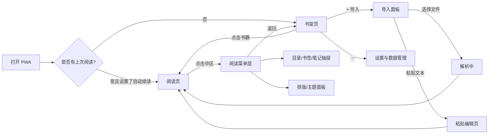

# 纸感离线阅读器（PWA）产品需求文档

2026-10-19 全球首发增补：当前中文品牌为“微光阅读”，英文显示名采用“LumiRead”；应用与商品标识沿用 `dev.jingye.reader` / `dev.jingye.reader.pro`。中英文支持的边界见第 18 节，早期名称与版本记录保留历史语义。

| 项目 | 内容 |
| --- | --- |
| 文档版本 | v0.1（初稿） |
| 日期 | 2026-10-02 |
| 状态 | 草案，待评审 |
| 产品形态 | PWA（渐进式 Web 应用），移动端优先 |
| 作者 | — |

**修订记录**

| 版本 | 日期 | 说明 |
| --- | --- | --- |
| v0.1 | 2026-10-02 | 首次撰写，定义 MVP 范围 |

---

## 1. 产品概述

### 1.1 暂定名称（候选）

| 名称 | 寓意 |
| --- | --- |
| **静页** | 安静的一页，直接点出“安静阅读” |
| **纸隙** | 纸与纸之间的缝隙，暗示从信息流中抽身 |
| **一页 OnePage** | 一次只看一页，克制、专注 |
| **素读** | 朴素地读，无修饰、无打扰 |
| **留白** | 东方美学，强调界面留白与心理留白 |

> 推荐：**静页**（易记、语义直接、域名/商标可用性较高，需后续核查）。

### 1.2 一句话定位

> 一款无需注册、无需联网、无 AI、无推荐的纸感阅读器——导入即读，读完即走，让普通手机在需要认真阅读时，暂时变成一台安静的阅读设备。

### 1.3 产品愿景

- 不是“又一个阅读 App”，而是一个**阅读状态切换器**：打开它，手机就“变成”电子纸阅读器。
- 用户的书、进度、笔记**只存在用户自己的设备上**。
- 用减法做产品：每增加一个功能，都要回答“它是否让阅读更安静”。

---

## 2. 背景与问题

### 2.1 现有阅读产品的痛点

| 痛点 | 具体表现 |
| --- | --- |
| 强制账号 | 打开先登录，绑定手机号、第三方账号 |
| 信息流打扰 | 书城、推荐、热榜、“猜你喜欢”、书友圈 |
| 广告与运营 | 开屏广告、章末广告、签到、任务、红包 |
| AI 过度介入 | AI 摘要、AI 问书，打断自主思考 |
| 隐私不透明 | 阅读行为被采集、用于画像 |
| 本地书体验差 | 对 TXT 编码识别差、EPUB 排版乱、导入流程繁琐 |
| 体积臃肿 | 安装包上百 MB，后台常驻、推送通知 |

### 2.2 目标用户画像

| 画像 | 描述 | 核心诉求 |
| --- | --- | --- |
| **深度阅读者** | 25–40 岁，读社科/文学，有 Kindle 但不常带 | 手机上也能像电子纸一样专注阅读 |
| **本地书收藏者** | 有大量 EPUB/TXT（网文、公版书） | 导入快、编码不乱码、章节识别准 |
| **长文稍后读者** | 常收藏公众号长文、论文、报告 | 粘贴即读、分页阅读、不被干扰 |
| **隐私敏感者** | 不愿注册、不愿被追踪 | 完全离线、数据可控、可导出 |

### 2.3 核心使用场景

1. 通勤地铁上，打开主屏幕图标，自动回到上次读到的位置，翻页继续读。
2. 睡前关闭灯，切到夜间墨黑主题，开启系统勿扰，读 30 分钟。
3. 在浏览器看到一篇长文，复制正文 → 粘贴到阅读器 → 变成可分页的“一本小书”。
4. 从网盘下载 EPUB，通过系统“分享 / 打开方式”直接导入。
5. 换手机前，导出备份文件；新手机导入后，书架、进度、笔记全部恢复。

---

## 3. 产品原则

所有需求决策以以下原则为准，冲突时原则优先：

1. **零注册**：没有账号体系，打开即用。
2. **零联网**：首次加载完成后，所有功能完全离线可用；运行时不发起任何网络请求（Service Worker 更新检查除外，且可关闭）。
3. **零追踪**：不接入任何统计、埋点、崩溃上报、第三方 SDK。
4. **零推荐**：没有书城、没有推荐、没有排行、没有社交。
5. **零 AI**：不提供 AI 摘要、问答、续写等功能。
6. **数据归用户**：所有数据本地存储，随时可完整导出、可一键清空。
7. **默认即最佳**：默认设置就应当好看好用，设置项克制。
8. **安静优先**：无通知、无红点、无弹窗营销、无成就打卡。

安卓本地听书例外：仅用户主动开始听书期间提供静默媒体控制通知。只选择已安装、标记为无需联网的系统语音；正文交给独立系统引擎处理，引擎可能拥有联网权限。暂停/停止、句级续读与本机临时缓存遵循 `TTS_PLAN.md`。

第一版免费策略（2026-10-20，取代 2026-10-14 的 iOS R2 买断方案）：所有已提供的功能免费开放，包括本地听书、笔记整理与摘录图片；移除 Pro 入口、付费提示、前端和原生购买限制，以及 StoreKit 购买和交易监听。iOS 系统语音须先下载并在实际设备断网试读，应用不提供云 TTS。当前未授权 iCloud、WebDAV、OPDS 或局域网同步，仍不接入这些服务。后文商业化设想仅为远期候选，不改变第一版免费范围。

---

## 4. 功能范围

### 4.1 版本规划总览

| 模块 | MVP（v1.0） | v1.x | 未来考虑 |
| --- | --- | --- | --- |
| 导入 | EPUB、TXT、粘贴文本、系统分享导入 | 文件夹批量导入、Markdown/HTML | FB2、MOBI（无 DRM） |
| 书架 | 列表、进度、排序、删除、重命名 | 分组/标签、搜索 | — |
| 阅读 | 分页、目录、进度条、沉浸全屏、常亮 | 书内全文搜索、竖排 | 双页（平板横屏） |
| 排版 | 字号、行距、段距、边距、缩进、字体 | 导入自定义字体 | 两端对齐 + 中文标点挤压 |
| 主题 | 4 套纸感主题 + 纹理 | 跟随系统深色、自定义配色 | — |
| 进度 | 锚点式自动保存 | — | — |
| 标注 | 书签、划线（3 色）、笔记、导出 Markdown | 笔记汇总页 | — |
| 数据 | 备份导出/恢复、持久化存储申请 | 定期备份提醒 | 局域网/文件互传（不经服务器） |
| 统计 | — | 本地阅读时长 | — |

### 4.2 明确不做（Not-Do 清单）

- 账号注册/登录、云同步服务
- 书城、书源、在线搜书、推荐、排行榜
- 社区、书评、分享到社交平台卡片
- AI 摘要、AI 问答、TTS 云服务
- 推送通知、签到、打卡、成就、徽章
- 广告、任何形式的数据变现
- DRM 加密书籍的解密

---

## 5. 信息架构

### 5.1 页面清单

| 页面 / 层 | 说明 |
| --- | --- |
| 书架页（首页） | 书籍列表，右上角“+”导入，左上角“⋯”进入设置/数据管理 |
| 导入面板 | 选择文件 / 粘贴文本 两个入口 |
| 粘贴编辑页 | 大文本框 + 标题输入 + “开始阅读” |
| 阅读页 | 全屏正文，无任何常驻 UI |
| 阅读菜单层 | 点击中区呼出：顶栏（返回、书名、书签）、底栏（目录、进度、排版、主题） |
| 目录 / 书签 / 笔记抽屉 | 左侧抽屉，三个 Tab |
| 排版设置面板 | 底部弹出 |
| 设置与数据管理页 | 全局默认排版、备份/恢复、存储占用、清空数据、关于 |
| 首次引导 | 3 屏以内：添加到主屏幕、建议开启勿扰、数据仅本地 |

### 5.2 页面流转



---

## 6. 功能需求详述

> 优先级：P0 = MVP 必须，P1 = MVP 尽量，P2 = 后续版本。

### 6.1 导入

#### 6.1.1 EPUB 导入（P0）

- **用户故事**：作为本地书收藏者，我希望选择一个 EPUB 文件后就能直接阅读，并保留目录和插图。
- **功能描述**
  - 通过 `<input type="file" accept=".epub,.txt">` 选择文件；支持一次多选。
  - 解析流程：解压 → 读取 `META-INF/container.xml` → 定位 OPF → 读取 metadata（书名、作者、封面）、manifest、spine → 读取目录（EPUB3 `nav.xhtml` 优先，回退 EPUB2 `toc.ncx`）。
  - 章节 XHTML 经过**净化**：移除 `<script>`、内联事件、外链资源；保留 ``（转为 Blob URL）；书内 CSS 仅保留安全子集（粗体、斜体、对齐、标题层级），字号/颜色/字体由阅读器统一控制。
  - 原文件以 Blob 存入 IndexedDB，解析结果（章节文本、目录）缓存以加速后续打开。
- **验收标准**
  - [ ] 标准 EPUB2 / EPUB3 均能打开，目录可点击跳转
  - [ ] 书名、作者、封面正确显示于书架
  - [ ] 插图正常显示且不超出页面宽度
  - [ ] 含脚本的 EPUB 不执行任何脚本
  - [ ] 50 MB 以内的 EPUB 可导入；超过时给出明确提示
- **边界情况**
  - DRM 加密：检测 `META-INF/encryption.xml`，提示“该书受版权保护，暂不支持”。
  - 无目录：以 spine 顺序生成“第 N 节”目录。
  - 损坏文件：提示“文件无法解析”，不写入书架。

#### 6.1.2 TXT 导入（P0）

- **用户故事**：作为网文读者，我希望导入 TXT 后不乱码，并能自动分出章节。
- **功能描述**
  - **编码识别**：依次检测 BOM → 尝试 UTF-8 严格解码（`TextDecoder('utf-8', {fatal:true})`）→ 失败回退 GB18030（兼容 GBK/GB2312）→ 再失败尝试 Big5 / UTF-16。阅读菜单中提供“切换编码”手动兜底。
  - **章节切分**：内置正则规则集，例如：
    - `^\s*第[零一二三四五六七八九十百千万0-9]+[章节回卷集部篇].*$`
    - `^\s*(Chapter|CHAPTER)\s+\d+.*$`
    - `^\s*(序章|楔子|前言|引子|后记|尾声|番外).*$`
    - 单行长度 ≤ 30 字才认定为标题，避免误判
  - 未识别到章节时，按约 5,000 字自动切分为“第 N 部分”。
  - **文本清洗**：统一换行符、合并多余空行、去除行首全角/半角空格（由阅读器统一缩进）。
- **验收标准**
  - [ ] UTF-8、GBK、GB18030 编码的中文 TXT 均不乱码
  - [ ] 常见网文格式章节识别准确率 ≥ 95%
  - [ ] 20 MB TXT（约 1000 万字）可导入，导入期间有进度提示且页面不卡死（解析放在 Web Worker）

#### 6.1.3 粘贴长文本（P0）

- **用户故事**：作为长文稍后读者，我希望把一篇文章粘贴进来，就能像读书一样分页阅读。
- **功能描述**
  - 粘贴编辑页：标题输入框（选填）+ 正文文本框 + “开始阅读”按钮。
  - 标题未填时，取正文第一行非空文本（截断 30 字）。
  - 支持读取剪贴板（`navigator.clipboard.readText()`，需用户手势触发；不支持时提示长按粘贴）。
  - 只保留纯文本；按空行/换行识别段落；若文本中含 Markdown 标题（`#`），转为章节。
  - 粘贴内容在书架中标记为“文稿”类型，可编辑标题与正文。
- **验收标准**
  - [ ] 粘贴 10 万字文本可在 1 秒内进入阅读
  - [ ] 段落划分正确，无连续空行
  - [ ] 未填标题时自动生成标题

#### 6.1.4 系统分享 / 打开方式导入（P1）

- Android：在 manifest 声明 **Web Share Target**（接收文件与文本）和 **File Handling**（`.epub` `.txt`），实现“分享到静页”“用静页打开”。
- iOS：不支持 Share Target，引导用户使用“文件”App 选择导入；在引导页说明差异。
- **验收标准**：Android Chrome 安装后，在文件管理器分享 EPUB 至本应用可直接导入。

### 6.2 书架（P0）

- **功能描述**
  - 列表视图（默认）：封面缩略图（无封面时生成纯色+书名的“纸质封面”）、书名、作者、阅读进度百分比、最后阅读时间。
  - 排序：最近阅读（默认）/ 导入时间 / 书名。
  - 长按书籍：重命名、查看信息（格式、大小、字数、导入时间）、删除（二次确认，并说明将同时删除笔记）。
  - 空状态：一句安静的文案 + “导入第一本书”按钮，不放任何推荐。
  - 顶部可选显示“继续阅读”卡片（最近一本）。
- **验收标准**
  - [ ] 100 本书时书架滚动流畅、首屏 < 500ms 渲染
  - [ ] 删除后存储空间被真正释放

### 6.3 阅读器核心（P0）

#### 6.3.1 分页

- 采用 **CSS 多栏（`column-width` = 视口宽度）+ `translateX` 位移**实现分页，单章渲染，章节边界无缝衔接到下一章。
- 页面严格对齐：每页底部不出现被截断的半行文字（行高与内容区高度取整对齐）。
- 图片：`max-width:100%; max-height:内容区高度; break-inside:avoid`。
- 章节首页留出上方约 1/4 空白，标题居中，营造纸书感。
- 预渲染相邻章节，翻到章节末尾时无白屏等待。

#### 6.3.2 翻页交互

| 操作 | 行为 |
| --- | --- |
| 点击屏幕右 1/3 | 下一页 |
| 点击屏幕左 1/3 | 上一页 |
| 点击屏幕中 1/3 | 呼出/隐藏阅读菜单 |
| 左右滑动 | 翻页（跟手） |
| 设置“单手模式” | 左右区都为下一页，仅左上角小区域为上一页 |
| 键盘 ←/→/空格/PageDown | 翻页（平板外接键盘、桌面） |

> 说明：Web 无法拦截手机音量键，音量键翻页不在 PWA 版本范围内。

#### 6.3.3 阅读菜单层

- 顶栏：返回书架、书名（单行省略）、添加/移除书签。
- 底栏：目录、进度条（可拖动，拖动时显示章节名与百分比，松手跳转，提供“回到跳转前位置”按钮）、排版、主题。
- 菜单出现时不改变正文布局（浮层覆盖）。

#### 6.3.4 页眉页脚信息

- 页眉：章节名（极小字号、低对比度）。
- 页脚：章内页码 `12 / 34` 与全书进度 `37%`；可在设置中关闭为“纯净模式”。
- 不显示时间、电量（避免焦虑；系统状态栏在全屏时隐藏）。

#### 6.3.5 沉浸与常亮

- 进入阅读页尝试请求全屏（Android）；iOS 依赖“添加到主屏幕”的 `display: standalone`。
- 使用 **Screen Wake Lock API** 保持屏幕常亮，可设置“阅读时常亮：关 / 5 分钟无操作后熄灭 / 始终”。

- **验收标准**
  - [ ] 翻页动画帧率 ≥ 55 fps（中端 Android 机型）
  - [ ] 改变字号后当前阅读位置偏差不超过 1 段
  - [ ] 横竖屏切换、软键盘弹出后重新分页且位置不丢失
  - [ ] 任何页面不会出现半行被截断

### 6.4 排版设置（P0）

| 设置项 | 范围 / 选项 | 默认值 |
| --- | --- | --- |
| 字号 | 14–28px，步进 1 | 18px |
| 行距 | 1.4 / 1.6 / 1.8 / 2.0 / 2.2 | 1.8 |
| 段距 | 0 / 0.5em / 1em | 0.5em |
| 页边距 | 窄 / 中 / 宽 | 中（左右 24px） |
| 首行缩进 | 开 / 关 | 开（2em） |
| 字体 | 系统衬线（宋体类）/ 系统无衬线（黑体类）/ 内置开源衬线体（如“霞鹜文楷”子集，可选下载缓存） | 系统衬线 |
| 对齐 | 两端对齐 / 左对齐 | 两端对齐 |
| 翻页动效 | 无 / 淡入 / 平移 | 平移 |

- 设置实时预览；可“应用为全局默认”或“仅本书”。
- **验收标准**：每项修改在 300ms 内生效并重新分页，位置保持。

### 6.5 纸感主题（P0）

| 主题 | 背景 | 正文 | 说明 |
| --- | --- | --- | --- |
| 米白纸（默认） | `#F5F0E6` | `#2B2B2B` | 模拟书籍纸张 |
| 浅灰纸 | `#EDEDEB` | `#262626` | 模拟电子墨水屏 |
| 护眼绿 | `#DCE8D6` | `#2A332A` | 传统护眼色 |
| 墨黑夜读 | `#141414` | `#9A9A93` | 低亮度、低对比，避免刺眼 |

- **纸张纹理**：可选极轻噪点纹理（SVG/CSS 生成，不使用大图），透明度 ≤ 4%。
- 夜间主题下图片自动降低亮度（`filter: brightness(0.8)`）。
- 可选“跟随系统深色模式”自动切换（P1）。

### 6.6 阅读进度自动保存（P0）

- **定位方式**：不保存“页码”，保存**内容锚点**：`{ chapterIndex, paragraphIndex, charOffset }`（EPUB 可兼容 CFI 思路），保证改字号、换设备尺寸后仍能回到同一段落。
- **保存时机**
  - 每次翻页后（防抖 500ms）
  - `visibilitychange` → `hidden`（切后台、锁屏）
  - `pagehide`（关闭页面）
- **恢复**：打开书籍时直接定位到锚点所在页；可设置“启动时自动打开上次阅读的书”。
- 同时记录全书进度百分比（按字符数计算）用于书架展示。
- **验收标准**
  - [ ] 阅读中直接杀掉浏览器/PWA 进程，重新打开回到同一页（误差 ≤ 1 页）
  - [ ] 修改字号后重新打开，回到同一段落

### 6.7 书签与划线笔记（P0）

#### 书签

- 顶栏书签按钮或下拉手势（P1）添加；书签记录锚点、章节名、该页前 50 字摘录、时间。
- 页面右上角显示极小的书签角标。

#### 划线与笔记

- 长按文字进入选区（使用系统原生选区，自定义菜单）：**划线**（3 色：朱砂红、墨蓝、琥珀黄；或下划线样式）、**笔记**、**复制**。
- 划线以 `{chapterIndex, startOffset, endOffset}` 存储，渲染时用 `<mark>` 包裹或 CSS Highlight API（支持时）。
- 点击已有划线：修改颜色、编辑笔记、删除。
- 目录抽屉中“书签 / 笔记”Tab 按章节顺序列出，点击跳转。
- **导出**：单本书的笔记导出为 Markdown（书名、作者、章节分组、原文引用 `>`、笔记、时间），通过下载或 Web Share 分享到其他 App。
- **验收标准**
  - [ ] 划线跨页、跨段落均可正确保存与显示
  - [ ] 修改排版后划线位置仍准确
  - [ ] 导出的 Markdown 在常见笔记软件（Obsidian、备忘录）中格式正常

### 6.8 本地备份与恢复（P0）

- **背景**：PWA 数据存储在浏览器中，可能因系统空间不足、清除浏览器数据、iOS 长期不使用而被清理，备份是数据安全的唯一保障。
- **功能描述**
  - 启动时调用 `navigator.storage.persist()` 申请持久化存储，并在数据管理页展示状态（已持久化 / 未持久化）。
  - 展示存储占用（`navigator.storage.estimate()`）。
  - **导出备份**，两种粒度：
    1. **轻量备份**（`.json`，KB 级）：书籍元数据 + 进度 + 书签 + 笔记 + 设置，不含书籍原文件。
    2. **完整备份**（`.zip`）：轻量备份 + 所有书籍原文件。
  - 文件命名：`静页备份_2026-10-02.zip`；通过下载或 Web Share 保存到网盘/文件。
  - **恢复**：选择备份文件 → 预览（书籍数、笔记数）→ 选择“合并”（默认，按书籍指纹去重，进度取最新）或“覆盖”。
  - 书籍指纹：文件内容 SHA-256（Web Crypto），用于去重与轻量备份匹配。轻量备份恢复时，若本地无对应书籍文件，显示“待补充文件”，用户重新导入同一文件后自动挂接进度与笔记。
  - **备份提醒**（P1）：距上次备份超过 30 天且有新笔记时，在书架页顶部显示一条可关闭的低调提示（非弹窗）。
  - **清空所有数据**：二次确认 + 输入“清空”确认。
- **验收标准**
  - [ ] 完整备份在另一台设备恢复后，书架、进度、笔记、设置完全一致
  - [ ] 轻量备份 + 重新导入原文件，可恢复进度和笔记
  - [ ] 备份文件为开放格式（JSON），用户可自行查看

### 6.9 “安静模式”引导（P1）

- 首次引导（≤ 3 屏，可跳过）：
  1. “你的书只在这台手机上”——说明数据本地化与备份的重要性。
  2. “添加到主屏幕”——分平台图示（iOS Safari 分享 → 添加到主屏幕；Android 安装提示 `beforeinstallprompt`）。
  3. “读书时，打开勿扰模式”——引导用户开启系统专注/勿扰（Web 无法代为开启，仅文字引导）。
- 阅读菜单中提供“安静提示”开关：进入阅读时淡入一行“已进入安静阅读”，2 秒后消失。

### 6.10 本地阅读统计（P2）

- 仅记录在本机：今日/本周阅读时长、每本书累计时长。
- 不做连续打卡、排行、分享海报。

---

## 7. 交互与视觉规范

### 7.1 视觉基调

- 关键词：**纸、墨、留白、克制**。
- 界面色只有背景色 + 文字色 + 一个强调色（朱砂 `#B5452F`，仅用于书签角标、划线、主按钮）。
- 图标：线性、1.5px 描边、无填充。
- 不使用阴影堆叠、渐变、毛玻璃等“数字感”效果。

### 7.2 阅读页点击热区

```
┌───────┬───────┬───────┐
│       │       │       │
│ 上一页 │  菜单  │ 下一页 │
│       │       │       │
│ 33%   │  34%  │  33%  │
└───────┴───────┴───────┘
```

### 7.3 动效

| 动效 | 时长 | 曲线 |
| --- | --- | --- |
| 翻页平移 | 220ms | `cubic-bezier(.2,.8,.2,1)` |
| 淡入翻页 | 160ms | ease-out |
| 菜单出现/消失 | 180ms | ease |
| 抽屉 | 240ms | ease-out |

- 尊重系统 `prefers-reduced-motion`，开启时所有动效降级为无。

### 7.4 可访问性

- 文字与背景对比度 ≥ 4.5:1（夜间主题刻意降低对比，但仍 ≥ 4.5:1）。
- 所有可点击元素热区 ≥ 44×44px。
- 支持屏幕阅读器读取正文（语义化 HTML）。

---

## 8. 非功能需求

### 8.1 性能

| 指标 | 目标 |
| --- | --- |
| 首次加载（4G） | < 2s，应用 JS+CSS（gzip）< 150KB（不含可选字体） |
| 二次打开（离线） | < 1s 进入书架 / 阅读页 |
| 打开 1000 章 TXT 书籍 | < 1.5s 显示当前页 |
| 翻页响应 | < 50ms 开始动画，动画 ≥ 55fps |
| 内存 | 阅读大书时常驻 < 150MB（只渲染当前及相邻章节） |

### 8.2 离线

- 使用 Service Worker 预缓存所有应用资源（App Shell）。
- 断网状态下全部功能可用。
- 版本更新：后台下载新版本，在书架页显示“有新版本，重启后生效”，不打断阅读；设置中可关闭自动更新检查。

### 8.3 兼容性

| 平台 | 最低版本 | 备注 |
| --- | --- | --- |
| iOS / iPadOS Safari | 16.4+ | 主屏幕 PWA；不支持 Share Target；存储可能在长期未使用时被清理 |
| Android Chrome / Edge | 近两年版本 | 完整支持安装、Share Target、File Handling |
| 桌面 Chrome / Edge / Safari / Firefox | 近两年版本 | 作为次要场景，支持键盘翻页 |
| 微信 / QQ 内置浏览器 | 不保证 | 检测后提示“请在系统浏览器中打开以离线使用” |

### 8.4 隐私与安全

- 无任何第三方脚本、字体 CDN、统计 SDK；所有资源同源。
- 严格 CSP：`default-src 'self'; img-src 'self' blob: data:; connect-src 'self'`，禁止内联脚本。
- EPUB 内容净化后再渲染（使用 DOMPurify 或等价方案），禁用脚本、iframe、表单、外链请求。
- 隐私声明页面：明确列出“我们不收集任何数据”，并说明唯一的网络请求是加载/更新应用本身。

### 8.5 存储

- 书籍文件、解析缓存、用户数据均使用 IndexedDB。
- 单本书上限 50MB（可配置），总量受浏览器配额限制，接近配额时提示用户清理或备份。

---

## 9. 技术方案建议

### 9.1 技术选型

| 层面 | 推荐 | 理由 |
| --- | --- | --- |
| 构建 | **Vite + TypeScript** | 快、产物小、生态成熟 |
| UI 框架 | **Preact**（或 SolidJS） | 体积约 4KB，React 写法，满足“极简轻量” |
| 状态管理 | Preact Signals | 轻量、细粒度更新 |
| 本地存储 | **Dexie.js**（IndexedDB 封装） | 支持索引、事务、版本迁移 |
| EPUB 解析 | **JSZip + 自研轻量解析器** | epub.js 体积大且维护不活跃，分页逻辑需要自控；自研只需解析 OPF/nav/ncx |
| 编码识别 | `TextDecoder` 原生 + 规则回退 | 零依赖 |
| HTML 净化 | DOMPurify | 安全、成熟 |
| 离线 | **vite-plugin-pwa（Workbox）** | 自动生成 Service Worker 与 manifest |
| 解析线程 | Web Worker（Comlink） | 大文件解析不阻塞 UI |
| 备份打包 | JSZip | 与 EPUB 解析复用 |
| 托管 | GitHub Pages / Cloudflare Pages | 免费、HTTPS、全球 CDN |
| 测试 | Vitest（解析器单测）+ Playwright（移动端视口 E2E） | — |

### 9.2 分页引擎方案对比

| 方案 | 优点 | 缺点 | 结论 |
| --- | --- | --- | --- |
| CSS Multi-column + translateX | 浏览器原生排版，性能好，支持图片/复杂 HTML | 需处理半行截断、计算总页数需等待布局 | **MVP 采用** |
| 逐段测量（Range/getClientRects）手动切页 | 精确控制每页内容 | 实现复杂、大章节测量慢 | 作为位置映射辅助 |
| Canvas 自绘 | 完全可控 | 失去选区、可访问性，成本高 | 不采用 |

**半行截断处理**：内容区高度 = `floor(可用高度 / 行高) × 行高`，剩余高度均分到上下边距。

**位置映射**：渲染后为每个段落建立 `段落索引 → 页码` 映射表；保存时取当前页首个可见段落 + 字符偏移，恢复时反查页码。

### 9.3 建议目录结构

```
src/
  app/            # 路由、全局状态、主题
  pages/          # Bookshelf / Reader / Import / Settings
  components/     # 通用 UI 组件
  reader/
    paginator.ts  # 分页引擎
    locator.ts    # 锚点与页码映射
    highlight.ts  # 划线渲染
  parsers/
    epub/         # container、opf、nav/ncx、sanitize
    txt/          # encoding、chapter-split、clean
    paste.ts
  workers/        # parse.worker.ts
  db/             # Dexie schema 与迁移
  backup/         # 导出、导入、合并
  styles/         # 主题 token、纸纹理
public/
  manifest.webmanifest
  icons/
```

---

## 10. 数据模型

```ts
interface Book {
  id: string;               // 内容 SHA-256
  type: 'epub' | 'txt' | 'paste';
  title: string;
  author?: string;
  coverBlobId?: string;
  fileBlobId?: string;      // 原文件，paste 类型为空
  encoding?: string;        // TXT
  charCount: number;
  chapterCount: number;
  importedAt: number;
  lastReadAt?: number;
  settingsOverride?: Partial<ReadingSettings>;
}

interface Chapter {
  bookId: string;
  index: number;
  title: string;
  level: number;            // 目录层级
  content: string;          // 净化后的 HTML 或段落数组 JSON
  charStart: number;        // 在全书中的起始字符位置（计算百分比）
}

interface Locator {
  chapterIndex: number;
  paragraphIndex: number;
  charOffset: number;
}

interface Progress {
  bookId: string;
  locator: Locator;
  percent: number;          // 0–100
  updatedAt: number;
}

interface Bookmark {
  id: string;
  bookId: string;
  locator: Locator;
  chapterTitle: string;
  excerpt: string;
  createdAt: number;
}

interface Highlight {
  id: string;
  bookId: string;
  chapterIndex: number;
  start: { paragraphIndex: number; charOffset: number };
  end: { paragraphIndex: number; charOffset: number };
  text: string;
  color: 'red' | 'blue' | 'yellow';
  note?: string;
  createdAt: number;
  updatedAt: number;
}

interface ReadingSettings {
  fontSize: number;
  lineHeight: number;
  paragraphSpacing: number;
  margin: 'narrow' | 'medium' | 'wide';
  indent: boolean;
  fontFamily: 'serif' | 'sans' | 'wenkai';
  align: 'justify' | 'left';
  theme: 'paper' | 'eink' | 'green' | 'night';
  texture: boolean;
  pageAnimation: 'none' | 'fade' | 'slide';
  tapMode: 'normal' | 'oneHand';
  showHeaderFooter: boolean;
  wakeLock: 'off' | 'idle5m' | 'always';
}

interface BackupFile {
  app: 'jingye';
  schemaVersion: number;
  exportedAt: number;
  books: Omit<Book, 'fileBlobId' | 'coverBlobId'>[];
  progress: Progress[];
  bookmarks: Bookmark[];
  highlights: Highlight[];
  settings: ReadingSettings;
}
```

---

## 11. 变现方案（不破坏产品原则）

前提：**核心阅读功能永久免费**，变现不引入账号、联网校验、广告或数据收集。

| 阶段 | 方式 | 说明 |
| --- | --- | --- |
| 早期 | **开源 + 打赏** | GitHub 开源（建议 AGPL/MIT 二选一），在“关于”页放打赏二维码/爱发电链接，不弹窗、不提醒 |
| 中期 | **支持者版（一次性买断）** | 解锁额外字体包、更多纸张主题、阅读统计、笔记高级导出等“锦上添花”功能；通过**离线激活码**（Ed25519 签名，内置公钥本地验签）激活，无需联网 |
| 中期 | **字体/主题包付费下载** | 与字体厂商合作授权的中文字体（字体授权是核心阅读之外的真实成本，用户容易理解） |
| 后期 | **上架应用商店付费下载** | 用 TWA（Android）/ Capacitor（iOS）打包；商店版可获得音量键翻页、真正的勿扰联动等原生能力，作为付费差异点；PWA 版保持免费 |

**明确拒绝**：广告、订阅制、会员积分、出售数据、导流书城。

**定价参考**：支持者版 ¥18–30 一次性；商店版 ¥12–25。

---

## 12. 风险与对策

| 风险 | 影响 | 对策 |
| --- | --- | --- |
| iOS 清理 PWA 存储 | 书籍与笔记丢失 | 申请持久化存储、显著的备份入口、备份提醒、引导添加到主屏幕（主屏幕 PWA 不受 7 天清理策略影响） |
| EPUB 排版差异大 | 部分书显示异常 | 统一接管样式、建立“问题书”测试集持续回归 |
| 大文件性能 | 卡顿、崩溃 | Worker 解析、按章懒加载、只渲染相邻章节 |
| 分页精度 | 半行截断、位置漂移 | 行高对齐算法 + 段落锚点定位 + 自动化截图测试 |
| 版权风险 | 法律问题 | 不提供任何书源、不支持 DRM 解密、用户协议声明仅阅读自有内容 |
| 微信内置浏览器 | 无法安装、存储不稳定 | 检测并引导用系统浏览器打开 |
| 无埋点难以了解用户 | 迭代缺乏依据 | 提供邮箱/GitHub Issues 反馈入口，自用驱动迭代 |

---

## 13. 里程碑与路线图

| 里程碑 | 目标 | 主要交付物 |
| --- | --- | --- |
| **M0 技术验证** | 验证分页引擎可行性 | TXT 导入 + 分页 + 翻页 + 进度保存的最小 Demo，在 iOS 与 Android 真机测试 |
| **M1 MVP** | 自己可以每天用 | EPUB 解析、粘贴导入、书架、目录、排版设置、4 套主题、书签划线笔记、备份恢复、PWA 离线安装 |
| **M2 体验打磨** | 可以推荐给朋友 | Share Target、首次引导、动效与纹理细节、笔记导出、性能优化、问题书兼容、隐私声明页 |
| **M3 公开发布** | 开源与早期变现 | 官网落地页、GitHub 开源、打赏入口、少数派/V2EX/即刻等渠道发布 |
| **M4 商业化** | 可持续 | 支持者版离线激活、字体包、应用商店上架版本 |

---

## 14. 成功指标

由于不做任何埋点，指标以可观察的外部信号和主观体验为主：

- **自用指标**：连续 30 天每日使用不想换回其他阅读 App；读完至少 3 本书。
- **体验清单**：MVP 所有验收标准 100% 通过；零数据丢失事故。
- **外部信号**：GitHub Star、Issues 反馈数量与质量、社区讨论热度。
- **变现信号**：打赏人数、支持者版激活码售出数。

---

## 15. 附录

### 15.1 竞品简析

| 产品 | 优点 | 与本产品差异 |
| --- | --- | --- |
| 微信读书 | 书库全、体验好 | 需账号、社交与推荐多、本地书支持弱 |
| Kindle App | 排版成熟 | 需亚马逊账号、对 EPUB/TXT 支持有限 |
| 静读天下（Moon+ Reader） | 功能强大、本地书友好 | 设置项繁多、界面偏“工具感”、仅 Android |
| Apple Books | 系统集成好 | 仅苹果生态、TXT 不支持 |
| Readest / Koodo Reader | 开源、跨平台 | 偏桌面端、功能偏全面，非“极简纸感”定位 |
| 各类网文 App | 内容丰富 | 广告、推荐、账号，正是本产品要远离的 |

**差异化总结**：本产品不在功能上竞争，而在“**安静**”上竞争——零账号、零联网、零打扰、纸感排版，打开即是阅读设备。

### 15.2 术语表

| 术语 | 解释 |
| --- | --- |
| PWA | 渐进式 Web 应用，可安装到主屏幕并离线运行的网页应用 |
| Service Worker | 浏览器后台脚本，用于缓存资源实现离线 |
| IndexedDB | 浏览器内置的本地数据库 |
| OPF / NCX / nav | EPUB 中描述元数据、目录的文件 |
| CFI | EPUB 规范中的内容定位标识 |
| Locator / 锚点 | 本产品用于记录阅读位置的结构（章节+段落+字符偏移） |
| TWA | Trusted Web Activity，将 PWA 打包为 Android 应用的方式 |
| Web Share Target | 让 PWA 出现在系统分享菜单中的 API |

## 16. Markdown 首版增补（2026-10-09）

用户授权优先支持普通文章与 AI 导出的 Markdown，此增补将原规划的 Markdown 文件导入提前到当前版本，HTML 文件导入仍不在范围内。

- 接受 `.md` / `.markdown`（忽略扩展名大小写），单文件上限 50 MB；解析在 Worker 中完成，保留原始字节。粘贴页显式选择纯文本或 Markdown，默认纯文本，旧文稿保持原规则。
- 支持六级标题与分层目录、段落、粗体/斜体/删除线、分隔线、引用、嵌套有序/无序列表、只读任务列表、GFM 表格、行内和块代码。代码保留缩进并自动折行；表格按行展示“表头：单元格”，不依赖横向滚动。
- 标题链接跳转到本书对应标题，重复标题有独立锚点。HTTP(S) 外链只显示地址并支持复制；不加载外部页面。图片显示替代文字和未加载说明；不下载远程图片。公式、Mermaid、原始 HTML 作为文字保留；暂不渲染公式、图表、HTML 或代码高亮，不支持本地图片附件。
- 接通分页、字号和主题、进度、书签、划线笔记、完整/轻量备份及补导。规范正文与实际 DOM 文本一致，持久化位置使用章节/段落/UTF-16 字符偏移，格式化标记不计入位置，表格标签和只读任务符号计入规范正文。
- MD 文件、MD 文稿与原纯文本使用不同指纹命名空间，防止重复判定或标注串用；独立记录 Markdown 解析版本。编辑文稿正文或切换格式须按现有流程确认重置已有标注。备份导出 v4，接受既有 v1/v2/v3，旧应用不接受 v4。
- 验收包括安全语法与稳定锚点的单元测试，浏览器文件/粘贴导入、窄屏代码/表格、目录/链接、夜间阅读及备份/标注往返。真实手机验收单独记录。
| Wake Lock | 保持屏幕常亮的 Web API |

## 17. Markdown 第二版增补（2026-10-09）

用户选择全部增强：公式、代码高亮、脚注、本地图片附件、Mermaid 与双链，继续以普通文章和 AI 导出内容为目标。

- 新导入或新建文稿使用 Markdown 解析版本 2，保留版本 1 的恢复、补导和旧书阅读规则；不自动重解析现有书籍，不改变原有标注位置。备份仍使用 v4，并明确记录 Markdown 版本；首版应用不能读取第二版文档元数据。
- `$...$` / `$$...$$` / `\(...\)` / `\[...\]` 公式由本地 KaTeX 转为原生 MathML，不下载数学字体；禁止公式中的链接、图片和 HTML 命令，错误或过大公式回退源码。常用语言（JavaScript、TypeScript、Python、JSON、CSS、HTML/XML、Shell、SQL）按围栏语言高亮，未知语言保留原文，不自动猜测。
- 支持 `[^标签]` 脚注与缩进的多段定义，按首次引用顺序编号，集中在末尾注释章节，可点按或通过目录跳转；缺失定义保留原始引用，重复定义明确报错。支持同文档 `[[标题]]` / `[[#标题|显示文字]]` 跳转，不引入跨书搜索、附件双链或 Obsidian 库管理。
- 本地图片以 `.md.zip` / `.markdown.zip` 图文包导入：仅一个 Markdown 正文及其图片文件夹，支持相对路径与 URL 编码名称。输入 50 MiB、条目 512、单条目 10 MiB、累计解压 60 MiB、图片 256 张上限；复用既有路径、流和 CRC 检查。PNG/JPEG/GIF/WebP 检查文件签名，SVG 复用静态净化规则，禁止外部图片/协议地址。原始 ZIP 字节完整保留，完整备份包含图文包，轻量备份须补导同一图文包。
- 本地 Mermaid 支持流程图、时序图、类图、状态图、ER 图、甘特图、饼图、Git 图、思维导图和时间线的安全语法。渲染前拒绝配置、用户 CSS、HTML、图片、外链和交互指令，严格模式生成后再次净化为本地 SVG 图片；错误或不支持的语法回退源码。限制源码 10,000 字符、200 行/分句、100 条边。
- 公式/图表视觉节点不计入文字位置，保留独立源码用于规范 UTF-16 定位。代码高亮不改变文字，图片延续图片段定位；分页、字号/主题、进度、标注及备份继续验收。全部按需渲染模块仍随应用离线缓存，不依赖 CDN 或远程资源。

## 18. 全球首发中英文支持（2026-10-19）

用户授权在 Devin 的 `b28ec9c` 中文改名基线上继续英文支持。

- 首发界面支持简体中文和英文。默认按系统语言优先级选择；没有匹配语言时使用英文。引导与设置均可手动选择“跟随系统 / 简体中文 / English”，偏好只保存在本机，不增加账号或在线翻译。
- 覆盖书架、导入、阅读设置、书签和笔记、回顾、备份、关于与隐私、错误提示、听书与购买界面；日期与排序采用对应地区格式。导出模板说明、文件名、摘录图片落款随界面语言变化。
- 书籍原文、用户书名、笔记、标签、锚点与原始字节不因切换语言而修改。既有解析规则和规范正文中的占位说明保持原样，避免改变定位；界面语言与正文排版语言独立。
- 听书保留已保存且仍可用的语音；尚未选择声音时优先提供与界面语言匹配的声音。声音是否离线可用、英文朗读质量与系统打断必须在实际 iPhone 上验证。
- iOS 原生错误和应用内语言保持一致；桌面显示名、系统文件/分享/购买面板遵循 iOS 自身的应用语言与商店地区。界面语言不决定购买币种，不写死金额。
- 英文与中文目录随应用打包，离线可用；不新增运行依赖、第三方翻译请求或网络权限。语言偏好为设备设置，不加入书籍备份；清空全部本地数据时重置。
- App Store 页面、内购本地化和正式截图由发布人员在 App Store Connect 配置，源码提交不代替后台配置、Xcode 验收或公开发布。
