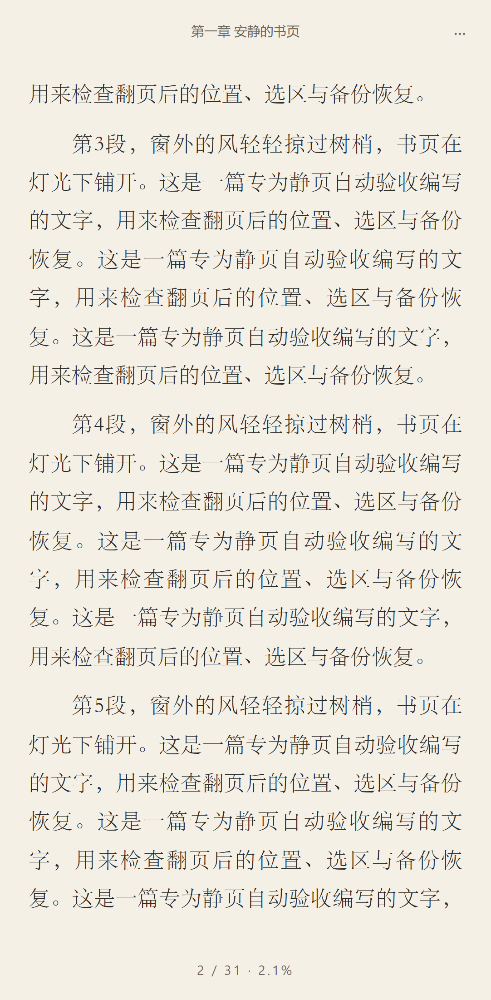

# 静页

纸感本地阅读器，产品需求见 [PRD.md](./PRD.md)，任务顺序见 [DEV_PLAN.md](./DEV_PLAN.md)。

[打开静页](https://jingye-reader.pages.dev/) · [项目源码](https://github.com/liaozhiliang222-cloud/reader) · [问题反馈](https://github.com/liaozhiliang222-cloud/reader/issues) · [贡献说明](./CONTRIBUTING.md) · [变更记录](./CHANGELOG.md)

当前为 0.0.1 预览版本，项目许可证待定。以下为隔离浏览器的实际界面截图，正文为原创验收文字，不代表物理手机验收。

 

`pnpm check:experience` 验证首次引导三屏、320px 键盘操作、重载、设置页复看与返回，以及受控安装事件、环境提示、IDB 写入故障和 Chromium 可信触摸。17 项通过；WebKit 未运行 CDP 触摸拖动，模拟 UA/安装事件不计真机安装。详情见 [浏览器验收](./e2e/README.md)。GitHub Actions 已准备 push/PR 的 lint、单测、构建和完整 E2E，实际 CI 结果与真机待办分别记录。

Markdown 支持 `.md` / `.markdown` 文件，以及在粘贴页选择 Markdown。标题生成分层目录，正文支持强调、引用、嵌套列表、只读任务列表、表格、代码和分隔线。表格逐行显示“表头：单元格”，适合分页和窄屏；代码保留缩进并自动折行。标题链接在本书内跳转，HTTP(S) 外链只提供地址和复制，原始 HTML 保留为文字。

第二版增加行内/块公式（`$...$`、`$$...$$`、`\(...\)`、`\[...\]`）、常用语言代码高亮、脚注、同文档标题双链（`[[标题]]` / `[[#标题|显示文字]]`）和 Mermaid 图表。带图片的文章，将一个 Markdown 文件和图片文件夹一起打包为 `.md.zip` / `.markdown.zip`，导入后可离线阅读并随完整备份保留；支持 PNG/JPEG/GIF/WebP 和安全静态 SVG。外部图片不加载，缺失附件显示说明。公式与图表不支持的语法回退源码；双链不跨书检索，不提供 Obsidian 库管理。已有首版书籍保持原解析规则及标注位置，重新导入相同原件不会自动升级。

MD 沿用字号、主题、进度、书签、划线、笔记与备份。粘贴格式默认纯文本，旧文稿不自动转换；修改正文或切换格式时，已有标注须在页面中确认重置。MD 文件原始字节和文稿原文均保留。备份导出升级为 v4，当前版本仍接受 v1/v2/v3；v4 备份需使用支持对应 MD 解析版本的应用恢复。运行 `pnpm check:markdown-v2` 可检查 Chromium/WebKit 移动视口下的首版、第二版、图片分页与既有分页像素基线，共 20 项。

Markdown 第二版已于 2026-10-09 部署到 [静页](https://jingye-reader.pages.dev/) 和现有 [自定义域名](https://reader.surveykit.cc/)。线上 MD 八项、真实旧客户端升级两项通过，最终缓存头修复后常规四项再次通过；具体构建与验收范围见 [部署记录](./DEPLOYMENT.md)。已安装旧版时回到书架点击“点击更新”，书籍、进度和笔记保留。原创图文体验包位于 `test-books/markdown-v2-demo.md.zip`，包含六项增强示例。

分享链路可用 `pnpm check:sharing` 独立验收：真实浏览器表单POST、Service Worker暂存、文件/文字导入、失败重试及跨标签原数据保留，六项通过。Chromium覆盖中文文件名；当前Windows WebKit的原生multipart中文文件名解析有已复现限制，其文件场景只覆盖英文名。此结果不等同于Android系统分享或iOS安装验收，详情见 [浏览器验收说明](./e2e/README.md)。

目前已实现 TXT/EPUB/Markdown 与文稿导入、本地书架、分页与进度恢复、目录跳转、排版主题、书签划线笔记、备份与恢复，以及 PWA 离线、系统分享、首次引导、安装/环境提示、翻页动效、单手模式、手动 TXT 编码、跟随系统深色与本地备份提醒。M1 主要代码已接入，阶段验收尚有待办；正在推进 M2。具体证据见 [DEVELOPMENT_STATUS.md](./DEVELOPMENT_STATUS.md)，未完成的回归见 [ISSUES.md](./ISSUES.md)。

已部署到 [静页阅读器](https://jingye-reader.pages.dev/)。这是0.0.1静态构建：书籍仍只在各自设备上处理，不上传到托管服务。本地开发地址与线上地址的数据分别保存；需要迁移时导出并恢复完整备份。部署步骤和验收范围见 [DEPLOYMENT.md](./DEPLOYMENT.md)。真实EPUB已取得21本、3个制作来源，42项双引擎正文验收及44张选定截图复核通过。真机安装、整本其他页面、7天自用和完整阶段验收继续待办。

## 本地运行

已接入双引擎移动视口E2E、分页像素回归、主动下载的同源文楷网页子集与关于/隐私页。运行 `pnpm e2e` 验证核心流程，`pnpm check:pagination` 验证行高回归能被检出；具体平台限制见 [浏览器验收说明](./e2e/README.md)。Playwright1.63.0仅开发使用，运行包贡献0。

可选字体由用户点击才下载1.53MB，校验后本地缓存；不点击时零字体请求。覆盖常用简体字符，生僻/未收录字使用系统字体。来源、OFL与复现见 [字体说明](./public/fonts/README.md)。`node scripts/licenses.mjs` 可重新生成直接与间接依赖的完整版权通知，当前共 138 项（包含包内声明依赖），JSZip选择MIT分支；正式项目许可待定。反馈使用 GitHub Issues 或 [liaozhiliang222@gmail.com](mailto:liaozhiliang222@gmail.com)，关于页仅在点击时打开入口，不自动发送书籍或设备信息。

第二版新增的 KaTeX 0.19.0 用于本地 MathML 公式，隔离压缩为 76.95 KB gzip；highlight.js 11.12.0 的核心与八种语言为 20.30 KB；DOMPurify 3.4.16 用于公式、高亮和 SVG 净化，为 11.03 KB；Mermaid 12.1.0 用于本地多类图表，含动态图表与布局依赖为 1465.72 KB。这些隔离值存在共享依赖，不能直接相加预测应用体积。最终构建全部 JS/CSS（含 Worker、Service Worker 与按需图表模块）为 1695.02 KB gzip，较首版 202.90 KB 明显增加，主要来自 Mermaid；初始主包加 CSS 为 99.01 KB。图表模块按需执行，但仍随应用离线缓存。原始测量见 `artifacts/markdown-v2-size.json`；这次增长不属于原先 150 KB 参考目标的小幅超出。

环境：Node.js 22.12+（当前验证 24.17.0）、pnpm 11.21.0。

```sh
pnpm install --frozen-lockfile
pnpm dev
```

打开终端显示的本地地址。开发时访问 `/?debug=1` 可展开底部日志，记录 console 输出、未捕获异常和 Promise 拒绝；最多保留 100 条，每条最多 2000 字符。不写入磁盘，也不发送日志。生产构建不包含此面板。

```sh
pnpm lint
pnpm test
pnpm build
pnpm preview
pnpm check:pwa
pnpm check:update
pnpm check:preferences
pnpm check:long-chapters
pnpm check:performance-browser
pnpm check:interactions
```

`pnpm format` 格式化新代码；原始需求和计划文档不自动重排。

## 安装与离线

正式构建通过 `vite-plugin-pwa` 的 `injectManifest` 生成安装清单和资源版本；Service Worker 预缓存应用壳、JS、CSS、解析 Worker 与本地图标，只处理应用同源资源。`pnpm dev` 不注册 Service Worker，避免开发缓存干扰；使用 `pnpm build`、`pnpm preview` 在本机验证正式构建。手机安装需要受信任 HTTPS，普通局域网 HTTP 不具备同样能力。

Android 在系统浏览器打开正式地址并选择“安装应用”；iOS Safari 使用分享菜单的“添加到主屏幕”。联网打开并完成资源准备后再离线使用。设置页显示离线资源状态；缺少 Service Worker 能力时明确提示。真机安装、主屏幕图标与飞行模式全功能目前尚未验收。

新版本下载后只在书架显示更新按钮；点击后激活并重载，阅读页及其他阅读标签不自动刷新。设置中可关闭静页主动定时检查，也可手动检查；浏览器自身仍可能在启动或导航时检查更新。旧资源暂时保留，供打开中的旧标签加载 Worker；没有窗口客户端的新版本激活时清理本应用作用域的旧缓存，不碰书籍数据库或其他应用缓存。

`pnpm check:update` 用当前源码的两个独立副本版本在本地执行真实SW更新，核对原生IndexedDB七张表和原文件SHA-256，验证手动重试、关闭主动检查及多标签页继续阅读；不改变当前源码版本，测试副本和服务均与用户浏览器隔离。详细报告在 `artifacts/update-regression.json`，真实Cloudflare旧→新客户端更新另在两个引擎通过，七表/原文/缓存SHA一致；报告见`artifacts/deployment-update-regression.json`。窗口计时器快进，手机仍须独立验收。

开启“启动时继续上次阅读”后，从没有显式 hash 路由的地址冷启动，会预载上次书籍并恢复锚点；设置、粘贴和书架的显式链接仍按链接打开。缺失或待补原文的上次书籍回到书架。当前已验证数据库重开后的状态选择与数据保留，中端机正文出现小于一秒尚未实测。

`pnpm check:pwa` 构建后在 Node 测试环境运行真实产物 `sw.js`，核对全部离线资源字节、解析 Worker、安装图标尺寸、导航查询参数、外部请求不拦截与显式更新消息；它不是浏览器或手机测试。随后统一测量包括 Service Worker 在内的全部 JS/CSS gzip。用户于2026-10-02将PRD的150 KB调整为参考目标，允许小幅超出；脚本超过该值给出提示，不再使检查失败，功能和产物检查仍须通过。

首次打开提供三屏引导，可跳过并保存在本机；设置页可重新查看。安装窗口仅在浏览器提供可安装事件且用户点击时触发，取消不影响阅读，不会自动弹出系统安装窗口。iOS展示Safari分享/添加图示及手动文件导入入口，说明参考[Apple使用指南](https://support.apple.com/en-au/guide/iphone/iph42ab2f3a7/ios)；安装事件生命周期参考[浏览器安装文档](https://web.dev/learn/pwa/installation-prompt)。微信/QQ内置浏览器和低于16.4的iOS显示可关闭提示，环境信息只在本机判断，不采集或上传。静页只说明系统勿扰的使用方式，不代用户切换系统状态。

阅读菜单提供“安静提示”开关，开启时进入阅读显示两秒，设置页可更改默认值。排版面板可选无/淡入/平移翻页，分别使用静态切换、160ms淡入、220ms平移；系统减弱动态会即时停止并禁用动效。菜单180ms、抽屉240ms，关闭期间不可交互后卸载。单手模式两侧点按下一页，左上角可回上一页，中间打开菜单；有文字选区或正在编辑标注时，左上返回禁用。滑动和键盘方向保持不变。动画使用[Web Animations API](https://developer.mozilla.org/en-US/docs/Web/API/Element/animate)，目标锚点先更新，动画不重建正文或改变保存位置。

`pnpm check:interactions`独立执行四个场景×两个引擎，直接观察原生动画、可信触摸点按、实时减弱动态取消/恢复、菜单和抽屉退出、单手区域、选区保护及横竖窗口重载。严格报告绑定本轮UUID、源码与构建SHA，截图复核另外记录。选区由DOM Range设置、媒体由浏览器接口模拟；物理手机长按选词、滑动/拇指误触与帧率仍待真机验证。

TXT 阅读菜单可手动选择 UTF-8、GB18030/GBK、Big5、UTF-16 LE/BE。原文件在 Worker 中严格解码，先预览再确认；确认后事务替换章节和近似百分比位置，失败回滚，原文件、指纹、书名和排版保留。正文改变的章节中，旧书签和划线笔记保留为“位置待确认”，可查看、编辑与导出，避免跳到无关文字或在正文上误画；正文完全未变的章节保留定位。旧阅读页的延迟进度保存与新标注写入有内容版本保护。完整恢复和轻量备份补导均沿用手动编码。

设置页可开启“跟随系统深色”。系统深色时显示墨黑，浅色时恢复所选纸张，状态栏颜色同步；系统变化不写回用户偏好。全局与单本会记住最后选择的浅色主题，手动夜读后仍可恢复，旧设置无历史时使用米白。

编码、系统主题和备份日期提醒已在Chromium/WebKit的十条实际浏览器流程通过，使用真实Worker、原生IndexedDB与实际文件下载。窄屏展开排版时顶栏保留空间，底部选项可滚动，返回书架仍可点击。`pnpm check:preferences`可单独复验并汇总本轮证据；媒体与日期是浏览器模拟，手机系统选区、状态栏与分享仍待真机验证。

## 系统分享与打开文件

Manifest 声明接收 EPUB/TXT 文件、文字和链接。安装后的支持平台可在系统分享菜单选择“静页”：文件通过 Service Worker 的 POST multipart 接口暂存在本机，再自动进入导入页；单本新书或已有书直接阅读，原有进度不覆盖。多本分享逐本处理，成功与失败分别显示，失败文件保留并可重试。

只有文字或链接的分享会进入粘贴页并预填标题/正文，检查后点击“开始阅读”；链接只作为文字，不请求网页。文件与文字混合分享分别处理，成功导入的文件从待处理暂存移除，未保存文字继续保留。书架显示待处理份数；可继续处理，也可明确放弃。暂存使用已有本地数据库的 blobs 表，成功后才清理，不新增数据库版本；不纳入正式书籍备份，覆盖书架恢复会保留暂存，“清空数据”会同时清除暂存。

分享请求按实际流字节限制在约101 MiB（含multipart开销），有效文件加文字总计最多100 MiB，文字最多50 MiB，单书仍由正式导入器执行50 MiB限制；过大时提示分批。文件字节保持原样，文字单独保存元数据，避免再次multipart编码改变换行。解析或后续存储失败时保留暂存原文；首次暂存失败会提示重新分享，已有书不会因重试被覆盖。

支持 File Handling 的浏览器会将“用静页打开”的文件交给同一暂存/导入流程，多个启动串行接收；单个文件读取失败不丢其他文件。正在处理分享或编辑文稿时，新文件留到书架处理，避免替换编辑内容。接口由浏览器和系统决定：[Chrome说明](https://developer.chrome.com/docs/capabilities/web-apis/file-handling)目前注明 File Handling 主要面向桌面系统；Android以 [Web Share Target](https://developer.chrome.com/docs/capabilities/web-apis/web-share-target) 为主要入口，iOS继续使用书架的“选择文件”。真实系统入口、浏览器权限和后台启动还未验收。

`pnpm check:pwa` 同时在断网Node环境执行正式SW的分享POST，检查303重定向前原生IndexedDB已经提交、暂存原文件字节和链接无外部请求。页面测试覆盖预填与保存失败不消费原文，不替代系统分享菜单或实际Worker验收。

## 手机验证

执行 `pnpm dev --host`，手机与电脑连接同一局域网，打开终端显示的 Network 地址。此方式仅用于界面预览；手机上的普通 HTTP 不等于安全上下文，后续 P-04 需配置受信任 HTTPS，再验收 Service Worker、剪贴板和常亮。

当前可检查：首页中文显示、窄屏无横向溢出、`?debug=1` 面板展开及清空。iOS 和 Android 真机尚待验收。

主题与字体现通过书架的“设置”或阅读菜单的“排版与主题”调整。设置页修改全局默认，阅读页修改仅本书，支持“应用为全局默认”。原开发阶段 query 主题预览以保存的正式设置为准。阅读链接使用 hash，刷新可恢复本书与进度。

书架的“导入书籍”面板提供文件多选和粘贴文本。多个文件逐本处理，损坏文件的错误单独显示；单本成功自动进入阅读，多本完成留在书架。相同内容不会覆盖已有进度。

文稿可留空标题，自动使用正文首行；`#` 到 `######` 标题转为章节。在书籍操作的“查看信息”中可编辑正文；只改标题保留进度，正文变化会从头阅读，已有书签与划线笔记会在确认后清除。书架支持最近阅读、导入时间和书名排序；长按或点击每行的“···”可重命名、查看信息、删除。

`node scripts/import-fixtures.mjs` 生成“2 本成功 + 1 个损坏文件”的多选样本，以及 10 万字 Markdown 文稿，供导入、编辑和性能回归。百书实际导入/本机首屏/虚拟滚动已有独立浏览器证据；多选失败/重复、文稿耗时与手机性能继续待验收。

阅读菜单已接入多级目录、进度条和“回到跳转前”。目录只生成视口附近的行，阅读器缓存当前章与前后相邻章，隐藏正文不进入屏幕阅读器。书签可在顶栏添加/移除，目录抽屉的书签页按内容位置列出；改字号时用同一锚点重新判断角标页。

排版面板提供“阅读时常亮”三档，菜单提供全屏入口。常亮实现包含页面可见性、系统释放和五分钟空闲处理；全屏在用户操作中请求，Android 点击书籍时也尝试进入。API 能力受浏览器与系统控制，参见 [Screen Wake Lock](https://developer.mozilla.org/en-US/docs/Web/API/Screen_Wake_Lock_API) 和 [requestFullscreen](https://developer.mozilla.org/en-US/docs/Web/API/Element/requestFullscreen)。真实设备五分钟不熄屏、全屏与书签分页效果尚未验收。

长按正文选择文字后，可添加朱砂红、墨蓝或琥珀黄划线、写笔记、复制。点击已有划线可以改色、编辑笔记或删除划线与笔记；清空笔记内容并保存会保留划线。抽屉的“笔记”页按章节和正文位置显示全部划线，点击摘录跳到原位置并提示一次，另有笔记编辑入口。

笔记页可下载单本书的 Markdown，包含书名、作者、章节、原文引用、笔记和时间；支持系统分享的浏览器也提供分享按钮。选区存储使用段落/UTF-16字符偏移，支持跨段范围，不存页码。渲染优先使用 [CSS Custom Highlight API](https://developer.mozilla.org/en-US/docs/Web/API/CSS_Custom_Highlight_API)，不支持时使用保留原有内联结构的 `<mark>`。DOM测试覆盖节点与选区稳定性，但当前浏览器工具未能启动，iOS/Android选区菜单、跨页显示、真实复制/分享和笔记软件打开效果仍待验收。

设置页提供备份与恢复。生成轻量 JSON 或完整 ZIP 后，可下载或系统分享；ZIP包含 `backup.json` 和 `books/` 下的原文件，文稿以保留空行和Markdown标题的 `.md` 原文保存。路径中的文稿指纹冒号转义为 `%3A`，可在Windows解压。原文件不可用时会明确列出数量，相关进度和笔记仍保留。

超过30天且有未备份的划线或笔记时，书架显示可关闭提醒，可直接进入备份区域；关闭状态在本机保存，该30天周期内不重复提示。未曾备份时，从第一条现存标注的创建时间计算。返回页面或系统日期变化时重新判断。只有交给浏览器下载或分享后才记录备份的快照时间；仅生成文件不计为已保存，取消分享或下载失败也不计。请确认文件实际保存到了浏览器之外。

恢复先预览书籍/书签/笔记/原文数量，再选择合并或覆盖。合并保留本机书名、排版与默认设置，进度和相同ID笔记采用较新的记录；空设备采用备份设置。覆盖替换书架、标注和设置，并要求确认，备份中的书可复用本机匹配原文。原文在Worker中重解析并核对指纹，全部写入在一个IndexedDB事务中完成。轻量备份缺原文时显示“待补充文件”，重新导入原书或粘贴相同文稿即可挂接。

清空数据必须在确认框输入“清空”；操作清理全部数据表并恢复默认设置。启动时申请持久化，设置页展示用量、配额和持久化状态；API不可用时显示未知，不当作零用量。是否批准由浏览器决定，参见 [StorageManager.persist](https://developer.mozilla.org/en-US/docs/Web/API/StorageManager/persist)。

导出快照在同一只读事务中按32本一批提取书籍信息，省略可重建的目录和章节摘要；进度、书签、笔记与设置保留。完整快照只记录原文键和大小，发送给Worker的输入不包含原文Blob。Worker通过回调逐书读取IndexedDB原文，检查大小与SHA-256；快照之后原文删除或改变会使整个导出失败，须重新生成。导出期间的新改名或笔记不改变已捕获的快照，旧备份中的目录/摘要仍可读取，完整恢复从原文重建。

完整ZIP复用解析Worker中的JSZip，通过公开 [generateInternalStream](https://stuk.github.io/jszip/documentation/api_jszip/generate_internal_stream.html) 和streamFiles逐书展开原文，输出按约1MiB转Blob，避免同时展开全部原文件和生成整包ArrayBuffer。导出前检查经典ZIP容量、20000条目及32MiB目录上限，超限不交付文件。单书Blob/ArrayBuffer、元数据和最终输出Blob仍占用内存，不等于直接写入磁盘或恒定总内存；大型书库峰值、真实手机恢复和系统分享仍待验收。ZIP中的`backup.json`限32MiB，读取时校验所有条目的大小、CRC与流边界，原文件指纹在写入前检查；浏览器实际下载和Windows独立解压已核对十三本原创样本。

## 依赖说明

- Preact：按计划用于轻量 UI。
- @preact/signals：响应式状态，用于阅读设置和开发日志。
- Vite、Preact preset、TypeScript、Node 类型：构建及严格类型检查。
- ESLint、typescript-eslint、globals：代码检查；Prettier：格式统一；Vitest：纯逻辑测试。

构建、类型与检查工具仅为开发依赖，浏览器交付贡献为 0；实际 gzip 体积见 DEVELOPMENT_STATUS.md 中的生产构建记录。未引入 CDN、统计或在线字体。

Dexie 用于本地事务与迁移；Comlink 用于 Worker 解析通信；fake-indexeddb 仅用于数据库测试，生产包贡献为 0。JSZip 用于 EPUB ZIP 解压，@xmldom/xmldom 用于 Worker 内解析 OPF/NCX/XHTML；解析结果重建为标签白名单节点，正文不使用 innerHTML，也不保留外部资源地址。

happy-dom 20.14.5 仅为选区、DOM标注与复制/下载测试提供环境，属于开发依赖，浏览器交付体积为0。它不提供真实分页布局或移动端系统菜单，不能代替浏览器与真机验收。

EPUB 接入后实际构建主包 gzip 49.10 KB，CSS 2.64 KB；Worker 用 Node gzip 实测64.47 KB（包含两个新增库、Comlink及解析逻辑，较原 Worker 约增加61 KB，不是单库独立体积）。这些资源均从本地构建交付。

多文件、文稿和书架管理接入后，无新增依赖。当前构建主包 gzip 53.35 KB、CSS 3.15 KB、Worker 用 Node gzip 实测64.82 KB；按构建报告与 Worker 实测合计约121.3 KB。各项属于整份构建产物体积。

相邻章预排版、目录、常亮与书签接入后，无新增依赖。最新构建主包 gzip 58.18 KB、CSS 3.54 KB，Worker 实测64.82 KB，合计约126.5 KB。前述体积保留作为各阶段基线。

划线、笔记和导出接入后，无新增运行依赖。执行 `pnpm build` 后运行 `node scripts/bundle-size.mjs` 可统一用 Node gzip 测量全部 JS/CSS（含 Worker）：本轮主包63.41 KB、CSS4.10 KB、Worker64.82 KB，总计132.34 KB。Vite单独显示主包64.01 KB、CSS4.11 KB，其压缩报告与脚本口径有差异，不混合计算总计。

备份与恢复接入后无新增依赖。默认设置与响应式状态拆开，使Worker不加载Preact UI代码；统一Node gzip实测主包69.12 KB、CSS4.20 KB、Worker68.49 KB，总计141.81 KB。Vite报告主包69.75 KB、CSS4.21 KB。全部体积包含Worker，不通过延迟加载排除其体积。

PWA 新增 vite-plugin-pwa 1.3.0 作为开发依赖，按计划生成 Manifest 和离线清单；插件及其构建依赖不进入浏览器包。缓存和注册使用本地小型实现，不引入 Workbox 运行时或 CDN。当前统一 Node gzip 实测主包70.65 KB、CSS4.23 KB、解析 Worker68.49 KB、Service Worker1.40 KB，总计144.77 KB（相较备份阶段增加约2.96 KB），含注册、更新界面、启动续读及缓存逻辑。192/512/maskable/180图标由 `node scripts/icons.mjs` 本地生成，没有新增图片或字体依赖。

系统分享/文件打开接入后无新依赖。Native IndexedDB 暂存避免在SW里加载Dexie；全部JS/CSS仍包括两个Worker，当前合计149.65 KB gzip。后续新增界面前需进一步优化构建体积；精确最终数值见 DEVELOPMENT_STATUS.md，不通过漏算Worker或修改预算满足要求。

引导、环境提示、动效和单手模式未保留新增依赖。Dexie使用同版本官方现代ESM入口，主页面暂存复用Dexie，SW保持原生IDB，二者共享记录编解码；库表和备份版本不变。该入口符合当前ES2022/Safari16.4目标，迁移、事务、跨适配器、备份恢复均经过自动回归。构建参考[Dexie官方包](https://github.com/dexie/Dexie.js/blob/master/package.json)。当前全部JS/CSS（含两个Worker）151.93 KB gzip；150 KB按本轮用户指令作为参考，过往硬预算记录仅为历史基线。Terser及JSZip源入口压缩实验没有保留，避免为了小幅体积收益增加构建路径。

执行 `node scripts/epub-fixture.mjs` 可在已忽略的 `test-books/` 生成自编带图 EPUB，供浏览器回归；解析单测另覆盖 EPUB2 NCX、EPUB3 nav、异常容器与危险内容。目录抽屉已接入，当前实现的目录与跨章交互仍待浏览器回归。

手动编码、系统主题和备份提醒未新增依赖。最新统一 Node gzip 主包78.63KB、CSS4.88KB、解析Worker68.70KB、SW3.33KB，全部JS/CSS共155.54KB；继续按150KB参考提示处理。53文件220项测试、lint、严格类型生产构建和实际SW的离线/分享产物检查通过，新增界面的真实浏览器与手机验收仍待完成。

大书性能优化已接入：超过5万正文字符或512段的章节按原段落范围分块，长章每块最多12000个UTF-16单位、128段，不拆代理对。阅读DOM保留当前与相邻块；空闲时逐块测量长章总页数，期间页脚先显示实际阅读百分比，测完再显示章内页码。后台、翻页、排版变化及关闭会取消测量，失败块不会无限重试。书签、划线和保存位置仍使用原段落偏移，EPUB保留行内结构和本地图像。

书架和目录只挂载视口附近的行，键盘方向键、Home/End和Tab可以跨窗口遍历，聚焦行在滚动时保留。离开窗口的封面会释放URL。书架逐条读取元数据后移除目录/章节摘要，阅读时重新读取完整记录；不修改存储中的原书。

`pnpm check:performance` 运行1000章和100本书的happy-dom/fake-indexeddb模型基准；设置环境变量 `JINGYE_PERF_REPORT=1` 会写入 `artifacts/performance-model.json`。它验证按需读取和DOM数量，不证明真实打开耗时、帧率或内存。`node scripts/performance-fixtures.mjs` 可生成相同原创千章文本、12万字单段、1000段长章及100本不同书架样本，全部写到已忽略的 `test-books/performance/`。开发地址 `?debug=1` 在本地日志面板显示正文读取/分块/目录/书架耗时，计时结束清理Performance条目；生产构建移除计时API和日志。旧M0-10桌面导入362ms与新模型路径不同，不据此宣称加速；真实设备打开<1.5s、滚动/55fps和30分钟内存仍待验收。

`pnpm check:long-chapters`单独验证真实长章布局：两种原创TXT、两个引擎，在分块边界前后翻页、字号28px/横竖窗口变化、重载后，原段落/UTF-16定位、书签笔记与原文件保持；实际Range行框完整，正文DOM峰值不超过4（包含一个临时测量块）。重载点击笔记及恢复竖窗后，实际划线Range在当前视口可见。报告在`artifacts/long-chapters-regression.json`。原创十二万字EPUB的12000切点注音、两张图片、含emoji的跨段选区及完整ZIP清空恢复也已接入；短ruby整体分块，不改变原段落/UTF-16定位。含注音或图片的阅读根使用文字mark高亮，避免原生高亮背景遮住读音/图片。逐个读音字符行框、28px横竖窗口和重载/跳转均有检查，截图另行复核；超长ruby仍按预算切块，不宣称完整巨大注音排版。

`pnpm check:performance-browser`以≥10MiB原创千章TXT和100本独立TXT实际导入，原生浏览器时钟测量开书、目录与书架首屏，并检查九处滚动后的可见行、Home/End、原文SHA及末章重载。发现WebKit逐条游标读取百书约1.4s，书架改为每批最多32条读入、立即去除目录字段，现代书复用已读摘要、旧书保留目录回填，正文仍按章读取。默认动态四项在完整回归通过：本机WebKit百书首屏206–275ms，千章打开双引擎60.6–180ms；这些数据来自Windows、移动视口与未限速环境，不能推断手机55fps、30分钟内存或首次4G加载。当前报告在`artifacts/performance-browser.json`，优化前失败基准在`artifacts/performance-shelf-before.json`；严格要求新UUID四份passed及真实媒体查询未减弱动态，不用旧报告补失败。修复已部署到现有Cloudflare项目。

EPUB兼容修复加入混合列表文字、祖先和行内注释锚点、表格按行分隔、诗歌换行/对齐、预格式文本及UTF-16 XML；仍统一使用阅读器横排和字体，不还原书内复杂CSS。规范IDPF字体混淆可导入但不使用其字体；正文加密及未知算法拒绝，参考[EPUB 3.3字体混淆规范](https://www.w3.org/TR/epub-33/#sec-resource-obfuscation)。新书保存parserVersion=3，增加本地SVG包装图片降级和基础静态矢量图净化；SVG以本地Blob图片显示，脚本/动画/外链/字体服务不保留，不完整支持混合图层、滤镜或复杂CSS。旧书补导/完整恢复按各自v1/v2规则重解析，不自动改变既有段落位置。不同版本的同指纹书籍不直接合并；请先保存本机备份，再选择完整覆盖恢复。新导出的备份版本为3，当前应用兼容版本1/2，旧应用会拒绝新备份，避免错误解释位置。

EPUB有界读取器先检查原始ZIP目录、名称、大小与范围，再以pako3.0.2逐块解压，限制输入50MiB、文件数20000、单条50MiB、累计实际解压150MiB；空条目、未使用资源、流结束和全部CRC均校验，不依赖JSZip内部元数据。备份JSON/ZIP metadata限32MiB，并使用相同目录/CRC读取器。备份预览逐块校验并丢弃原文，仅保存选中的File和元数据；恢复重新核对元数据、逐书读取/指纹验证/解析/本地暂存，最后检查未引用条目，再在同一事务内校验位置和写入，失败整体回滚。可以取消恢复，完成或失败后清理暂存。JSZip仍用于完整导出，快照只含元数据和原文键，单书工作集、元数据、最终导出Blob及浏览器内部内存仍有占用，详见 [安全边界](./SECURITY.md) 和DATA-01待办，不能称完整审计或恒定内存已通过。

`node scripts/compat-fixtures.mjs` 生成20种原创EPUB结构到 `test-books/generated-compat/`，首次创建 `test-books/COMPAT.md` 后不覆盖人工记录。`pnpm test -- src/parsers/epub/compat.test.ts` 自动检查正文与目录锚点；这些是合成样本，不能替代计划中的20本不同来源真实书籍和浏览器视觉验收。本轮无新增依赖，66文件277项测试、lint、build及产物离线检查通过，全部JS/CSS含两个Worker为161.82KB gzip；150KB仍是参考值。

真实版本由 `pnpm fixtures:real-epub` 下载并保存来源、开放依据、日期与原文件SHA-256；文件全部留在忽略目录。`pnpm check:compat` 使用独立配置验收实际导入、指定正文目录、翻页、重载及图片边界。当前取得21本未改动原件、3个制作来源，包含中文/英文小说、诗歌、边注、代码/真实表格，以及13章日文《草枕》的4603个注音和原竖排样式；统一横排。Eloquent官网EPUB实际为2018年第三版。42项双引擎完整UI导入/正文可见/逐行及图片边界/翻页重开/原文SHA检查通过，44张选定正文及表格截图已查看，达到至少20本数量目标；4个候选下载不可用明确skip。每次UUID锁定原件和构建，严格汇总见artifacts/compatibility-progress.json；逐书问题与处理在test-books/COMPAT.md。部分EPUB目录仅列许可/附录时，新解析器补充缺失正文节，不改变原fragment。图片段无缩进，避免分页边缘溢出；v3支持SVG包装降级与安全静态子集，复杂图层及整本视觉继续待验收。

本轮真实EPUB验收修复了无字框源空白导致的分页锚点退回，以及同章目录片段跳转后的页眉/书签章名；原文、段落与UTF-16位置、parserVersion=3和备份格式保持。新增5项单测，75文件337项、lint/build和完整本地62项中61通过/1既有WebKit离线模拟skip。全部JS/CSS182.20KB gzip、可选字体另1.53MiB，无新依赖。上述结果不证明整本所有布局、原竖排保真或物理手机验收。

本轮M2-04/05原生交互八项及六张选定截图复核通过，修复单手返回在文字选区期间误翻页。当前lint、75文件337单测、strict构建及完整70项中69通过/1既有WebKit离线模拟skip；Cloudflare新版四项、旧D6→BA实际更新两项及Windows独立解压26原文核对通过。新构建全部JS/CSS182.22KB gzip、可选字体另1.53MiB，无新增依赖。真实21本EPUB42项证据来自前一D6构建，解析器和CSS仍相同；物理手机长按/滑动、安装/性能与7天自用继续待办。
